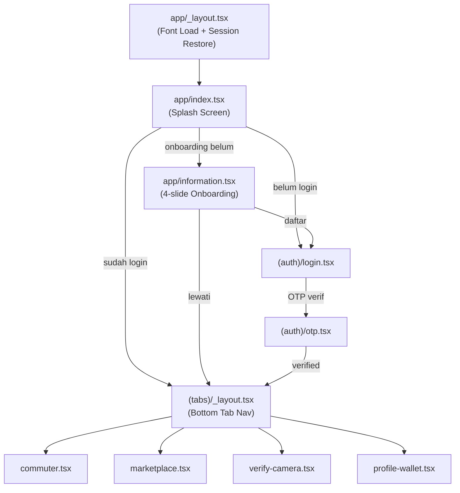

# Mobile Technical Document (MTD)
# JEJARING-SEWU (SINERGI-PEKON) — Aplikasi Mobile Warga

> **Proyek:** JEJARING-SEWU (SINERGI-PEKON) — Circular Economy Engine Berbasis Pekon  
> **Subproject:** `Mobile2/` — React Native Expo (SDK 54+)  
> **Platform Target:** Android (Utama), iOS (Tersier)  
> **Versi Dokumen:** 1.0.0  
> **Tanggal Pembuatan:** 4 November 2026  
> **Status:** Dokumen Hidup (Living Document)

---

## 1. Executive Summary

**JEJARING-SEWU** adalah platform ekonomi sirkular berbasis Pekon (Desa) yang menghubungkan warga, BUMDes, dan pemerintah daerah Kabupaten Pringsewu. Aplikasi mobile (`Mobile2/`) merupakan **client utama** yang melayani warga Pekon — petani, pengepul, pekerja harian, lansia, penyandang disabilitas, ibu rumah tangga (PEKKA), dan pelaku UMKM lokal.

Aplikasi dibangun di atas **React Native + Expo SDK** dengan arsitektur feature-first (FDD), menggunakan **PanelUI** sebagai design system berbasis Tailwind/Uniwind untuk tampilan, **Zustand** untuk state management, **Expo Router** untuk navigasi file-based, dan **Expo SecureStore** untuk penyimpanan token yang aman di hardware-backed keystore perangkat Android.

**Tiga domain ekonomi utama** yang dilayani:
1. **Nebeng-Jastip** — Rute searah komuter pekon ke pasar, titip beli barang, berbagi bensin secara digital.
2. **Bursa Panen & Mini-Job** — Lelang komoditas pertanian, bursa pekerjaan mikro inklusif zero-discrimination.
3. **Selfie PoW & Skor Kredit BUMDes** — Verifikasi fisik dengan selfie berkriptografi, pemicu kalkulasi skor kredit alternatif AHP-TOPSIS, dan rekomendasi modal tanpa agunan Rp1.500.000.

---

## 2. Arsitektur Teknis Mobile

### 2.1 Tech Stack

| Layer | Teknologi | Keterangan |
|:---|:---|:---|
| **Framework** | React Native (Expo SDK 54+) | Managed Workflow, EAS Build Ready |
| **Bahasa** | TypeScript (strict mode) | Tipe ketat end-to-end |
| **Navigasi** | Expo Router (file-based, App Router) | Stack + Tab navigation |
| **UI Library** | PanelUI (Uniwind + NativeWind/Tailwind) | Custom design system berbasis utility class |
| **Font** | Geist + GeistMono (`@expo-google-fonts`) | Loaded via `useFonts`, semua varian bold eksplisit |
| **State Global** | Zustand | Auth store, Commuter store |
| **HTTP Client** | Axios (`services/api.ts`) | Base URL `/api/v1`, Bearer token, error normalization |
| **Secure Storage** | `expo-secure-store` | Keystore (Android) / Keychain (iOS) |
| **Local DB (Offline)** | `expo-sqlite` | Antrean mutasi offline (PoW queue, nutrition redeem) |
| **Kamera** | `expo-camera` | Direct capture only, tanpa akses galeri |
| **Lokasi GPS** | `expo-location` | Foreground permission, `ST_DWithin` radius komuter |
| **Manipulasi Gambar** | `expo-image-manipulator` | Compress + resize sebelum upload PoW |
| **Hashing** | `expo-crypto` | SHA-256 untuk image integrity + device ID generation |
| **Animasi Splash** | `lottie-react-native` | JSON Lottie animation (Docs/Design/Android_Compact_-_1.json) |
| **Konektivitas** | `@react-native-community/netinfo` | Deteksi blank-spot, trigger offline sync |
| **Icons** | `lucide-react-native` | Konsisten dengan design system |
| **Backend** | NestJS `/api/v1` | Base URL: `http://localhost:4000/api/v1` (dev) |

### 2.2 Struktur Direktori

```
Mobile2/
├── app/
│   ├── _layout.tsx              # Root Stack: font load, session restore, provider setup
│   ├── index.tsx                # Splash screen (Lottie) + routing logic berdasarkan auth & onboarding
│   ├── information.tsx          # Onboarding 4-slide (Figma-based) → daftar / lewati
│   ├── (auth)/
│   │   ├── _layout.tsx
│   │   ├── login.tsx            # Login No HP/Email + Password
│   │   ├── otp.tsx              # Verifikasi OTP 6-digit (FCM)
│   │   └── register.tsx         # Registrasi berbasis NIK KTP
│   └── (tabs)/
│       ├── _layout.tsx          # Bottom tab: Nebeng-Jastip | Bursa & Job | Selfie PoW | Dompet & SPK
│       ├── commuter.tsx         # Tab 1: Nebeng-Jastip
│       ├── marketplace.tsx      # Tab 2: Bursa Panen & Mini-Job
│       ├── verify-camera.tsx    # Tab 3: Selfie PoW (Kamera Langsung)
│       └── profile-wallet.tsx   # Tab 4: Dompet, Skor Kredit, Profil, Gizi
│
├── features/
│   ├── auth/           # API, Store (Zustand), Types, Schemas, Form Components
│   ├── commuter/       # API, Store, Components (ModeSwitcher, RouteCard, Modals)
│   ├── harvest/        # API, Components (ListingCard, CreateModal, BidModal)
│   ├── mini-job/       # API, Components (JobCard, FilterBar, CreateModal)
│   ├── transaction-pow/ # API, Components (CameraViewfinder, PoWReviewView, TxSelector)
│   ├── wallet/         # API, Components (BalanceCard, LedgerHistoryList)
│   ├── credit-scoring/ # API, Components (CreditScoreCard)
│   └── nutrition/      # API, Components (CatalogModal, Banner, PackageCard)
│
├── components/ui/      # PanelUI design system (Button, Card, Badge, Input, BottomSheet, dll)
├── context/            # AuthContext (wrapper useAuthStore + loginAsDemoWarga + logout)
├── services/
│   ├── api.ts          # Axios instance + deviceId + error interceptor
│   ├── secure-storage.ts # Wrapper expo-secure-store + STORAGE_KEYS konstanta
│   ├── sqlite.service.ts # Offline queue: queueOfflineTask, getPendingOfflineTasks
│   └── sync.service.ts  # Background sync logic
├── hooks/
│   ├── use-auth-protection.ts # protectedAction (AuthWall for guest users)
│   ├── use-back-handler.ts
│   ├── use-color-scheme.ts    # Dark/light mode
│   └── use-theme.ts
├── constants/Config.ts       # STORAGE.DOWNLOAD_URL, BUCKET (Backblaze B2)
├── assets/animations/splash.json  # Lottie splash animation
└── global.css                # Tailwind utility classes + font-geist-* utilities
```

### 2.3 Pola Arsitektur



---

## 3. Alur UX & Navigasi

### 3.1 Alur Lengkap (dari Instalasi)

```
Splash Screen (index.tsx, Lottie 2–3 detik)
    ↓
[Cek SecureStore: onboarding_completed?]
    ├── TIDAK → Information Screen (4 Slide Onboarding)
    │               ├── Slide 1–3: Info fitur + tombol Sebelumnya/Selanjutnya
    │               └── Slide 4 (CTA): "Daftar Menjadi Bagian" + "Eksplor Terlebih Dahulu"
    │                       ├── Daftar → (auth)/login (atau register)
    │                       └── Lewati → (tabs)/ [Mode Tamu]
    └── YA → [Cek SecureStore: access_token?]
                ├── ADA → (tabs)/ [Mode Login]
                └── TIDAK → (tabs)/ [Mode Tamu / AuthWall aktif]
```

### 3.2 Mode Tamu (Guest Mode)

Seluruh 4 tab dapat diakses tanpa login. Namun, aksi yang membutuhkan identitas warga (klaim job, buka rute, posting panen, foto PoW, tukar poin gizi) akan memunculkan **AuthWallSheet** — BottomSheet dengan opsi "Masuk Akun" atau navigasi ke login. Ini memungkinkan eksplorasi konten sebelum registrasi.

---

## 4. Analisis Kesesuaian Fitur (Gap Analysis)

### 4.1 Matrix Status Fitur

| Domain / Fitur | Status | Prioritas | Catatan |
|:---|:---:|:---:|:---|
| **AUTH & ONBOARDING** | | | |
| Splash Screen (Lottie adaptive dark/light) | ✅ Selesai | P0 | `app/index.tsx` + Lottie |
| Information Screen (4-slide onboarding) | ✅ Selesai | P0 | Figma-based, `app/information.tsx` |
| Login No HP/Email + Password | ✅ Selesai | P0 | `(auth)/login.tsx` |
| OTP 6-digit (FCM) | ✅ Selesai | P0 | `(auth)/otp.tsx` |
| Registrasi berbasis NIK KTP | ✅ Selesai | P0 | `(auth)/register.tsx`, pekon picker |
| Session Restore (SecureStore) | ✅ Selesai | P0 | `useAuthStore.restoreSession()` |
| Token Refresh Rotation | ⚠️ Parsial | P1 | Disimpan di SecureStore, belum ada auto-refresh interceptor di Axios |
| Google OAuth2 Login | ⚠️ Parsial | P2 | `authApi.googleLogin()` ada, UI belum dibuat |
| Lupa Kata Sandi (OTP) | ⚠️ Parsial | P2 | `authApi.forgotPassword()` + `resetPassword()` ada, UI belum ada di mobile |
| Guest Mode (AuthWall) | ✅ Selesai | P1 | `useAuthProtection` + `AuthWallSheet` |
| **KOMUTER / NEBENG-JASTIP** | | | |
| Mode Switcher Warga / Kurir | ✅ Selesai | P0 | `CommuterModeSwitcher` |
| Tampilkan rute komuter terdekat (nearby) | ✅ Selesai | P0 | `commuterApi.getNearbyRoutes()` |
| Filter radius (10/25/50 km) | ✅ Selesai | P1 | Selector radius di UI |
| Buka rute baru sebagai Kurir | ✅ Selesai | P0 | `CreateRouteModal` + `commuterApi.startRoute()` |
| GPS Ping/Broadcast (interval 15s) | ✅ Selesai | P1 | `setInterval` + `commuterApi.pingGps()` |
| Menyetujui titipan jastip (kurir) | ✅ Selesai | P0 | `commuterApi.acceptJastipOrder()` |
| Menitip barang ke rute komuter (warga) | ✅ Selesai | P0 | `CreateOrderModal` + `commuterApi.createJastipOrder()` |
| Selesaikan rute perjalanan | ✅ Selesai | P0 | `commuterApi.finishRoute()` |
| GPS Background Tracking (expo-task-manager) | ❌ Belum | P1 | Direncanakan TAD — saat ini hanya foreground interval |
| Peta Visual Rute (MapView) | ❌ Belum | P2 | Tidak ada integrasi peta saat ini |
| Geo-fenced push notif ke tetangga | ❌ Belum | P2 | Butuh FCM + backend `routes/start` trigger |
| **BURSA PANEN (HASIL BUMI)** | | | |
| Tampil listing panen terbuka | ✅ Selesai | P0 | `HarvestListingCard` + `harvestApi.getListings()` |
| Posting lelang komoditas (petani) | ✅ Selesai | P0 | `CreateHarvestModal` + `harvestApi.createListing()` |
| Ajukan penawaran harga (pengepul) | ✅ Selesai | P0 | `PlaceBidModal` + `harvestApi.placeBid()` |
| Setujui tawaran + kunci transaksi | ✅ Selesai | P0 | `harvestApi.acceptBid()` → UnifiedTransaction |
| Filter pekon / komoditas / status | ❌ Belum | P1 | Hanya filter status saat ini |
| Direktori Pengepul Terpercaya (referral) | ❌ Belum | P2 | Endpoint `/harvests/collectors/trusted` belum dikonsumsi |
| Input referral code pengepul | ⚠️ Parsial | P2 | Field di `PlaceBidModal` ada, belum divalidasi UI |
| **BURSA MINI-JOB** | | | |
| Tampil katalog pekerjaan mikro | ✅ Selesai | P0 | `MiniJobCard` + `miniJobApi.getJobs()` |
| Filter (ALL / DISABILITY / OPEN) | ✅ Selesai | P0 | `MiniJobFilterBar` |
| Posting lowongan pekerjaan (UMKM) | ✅ Selesai | P0 | `CreateMiniJobModal` + `miniJobApi.createJob()` |
| Klaim tugas (Auto-Accept Lock) | ✅ Selesai | P0 | `miniJobApi.claimJob()` + Zero-discrimination info banner |
| Flag Ramah Disabilitas | ✅ Selesai | P0 | `isDisabilityFriendly` di UI + create modal |
| Prinsip Zero-Discrimination Banner | ✅ Selesai | P0 | Ditampilkan di marketplace tab |
| Idempotency-Key saat klaim | ⚠️ Parsial | P1 | Header `X-Idempotency-Key` belum di-generate di mobile |
| **SELFIE PROOF-OF-WORK (PoW)** | | | |
| Camera Direct Capture (kamera langsung) | ✅ Selesai | P0 | `expo-camera`, tanpa galeri |
| Kalkulasi SHA-256 Hash gambar | ✅ Selesai | P0 | `expo-crypto` + FileReader |
| Kompres & resize sebelum upload | ✅ Selesai | P0 | `expo-image-manipulator` (resize 1080px, compress 0.7) |
| GPS tagging foto (lat/lng/accuracy) | ✅ Selesai | P0 | `expo-location` |
| Pilih transaksi aktif (selector modal) | ✅ Selesai | P0 | `TransactionSelectorModal` |
| Submit PoW ke backend (atomik 5 langkah) | ✅ Selesai | P0 | `transactionApi.submitSelfiePoW()` |
| Review foto sebelum submit | ✅ Selesai | P0 | `PoWReviewView` |
| Watermark GPS + Nama Pekon + Timestamp | ⚠️ Parsial | P1 | Dikirim sebagai metadata JSON, belum di-overlay ke file foto |
| Offline Queue untuk PoW (sinyal blank-spot) | ⚠️ Parsial | P1 | SQLite service ada, namun PoW belum terintegrasi ke offline queue |
| Upload foto ke Backblaze B2 | ⚠️ Parsial | P1 | URL B2 di-construct dari `Config`, belum ada upload flow sesungguhnya |
| **WALLET & BUKU BESAR** | | | |
| Tampilkan saldo poin & komisi | ✅ Selesai | P0 | `WalletBalanceCard` + `walletApi.getMyWallet()` |
| Riwayat mutasi buku besar (ledger) | ✅ Selesai | P0 | `LedgerHistoryList` + filter IDR/POINTS/ALL |
| Offline status banner | ✅ Selesai | P1 | NetInfo listener + sync button |
| Offline sync mutasi pending | ✅ Selesai | P1 | `syncPendingTasks()` + SQLite |
| Penarikan saldo | ❌ Belum | P2 | Tidak ada endpoint withdrawal di backend plan |
| **SKOR KREDIT (SPK AHP-TOPSIS)** | | | |
| Tampilkan skor kredit terkini | ✅ Selesai | P0 | `CreditScoreCard` + `creditScoringApi.getMyScore()` |
| Rincian 5 variabel SPK | ✅ Selesai | P0 | Ditampilkan di CreditScoreCard |
| Grade A/B/C + visual | ✅ Selesai | P0 | GRADE_A/B/C dengan label & warna |
| Klaim rekomendasi modal BUMDes | ⚠️ Parsial | P1 | Alert dialog saja, belum hit API `/credit-scoring/loans/eligible` |
| Grafik historis skor | ❌ Belum | P2 | Tidak ada chart/grafik riwayat skor |
| **INTERVENSI GIZI / STUNTING** | | | |
| Banner intervensi gizi | ✅ Selesai | P0 | `NutritionInterventionBanner` |
| Katalog paket pangan bergizi | ✅ Selesai | P0 | `NutritionCatalogModal` + `nutritionApi.getPackages()` |
| Tukar poin ke paket gizi | ✅ Selesai | P0 | `nutritionApi.redeemPackage()` + validasi poin |
| Offline queue redeem gizi | ✅ Selesai | P1 | `queueOfflineTask()` saat blank-spot |
| Fallback data paket gizi (lokal) | ✅ Selesai | P1 | `FALLBACK_NUTRITION_PACKAGES` |
| **AKSESIBILITAS** | | | |
| Toggle ukuran huruf besar (Lansia) | ✅ Selesai | P1 | `isLargeFont` toggle di profile tab |
| ARIA Labels & accessibilityRole | ✅ Parsial | P1 | Offline banner, tombol PoW ada label; masih perlu audit menyeluruh |
| TalkBack / Screen Reader | ❌ Belum | P2 | TAD menyebutkan TalkBack support, belum diimplementasi |
| **TEKNIS & INFRASTRUKTUR** | | | |
| Font Geist (semua varian) | ✅ Selesai | P0 | `useFonts` di `_layout.tsx`, 63 asset terverifikasi |
| Dark/Light Mode adaptive | ✅ Selesai | P0 | `useColorScheme`, PanelUI theming |
| Axios API Client + Error normalization | ✅ Selesai | P0 | `services/api.ts` |
| Device ID Generation (Crypto UUID) | ✅ Selesai | P0 | `getOrCreateDeviceId()` di `services/api.ts` |
| SQLite Offline Queue | ✅ Selesai | P1 | `sqlite.service.ts` |
| Background sync service | ✅ Parsial | P1 | `sync.service.ts` ada, integrasi ke task manager belum |

**Legenda:** ✅ Selesai &nbsp;|&nbsp; ⚠️ Parsial &nbsp;|&nbsp; ❌ Belum

---

## 5. Yang Sudah Dibangun (Implemented Features)

### 5.1 Alur Onboarding & Navigasi

Alur navigasi pengguna pertama kali telah diimplementasikan secara lengkap:
- [`app/index.tsx`](file:///D:/Projects/KompasIptek/Mobile2/app/index.tsx) — Splash screen dengan animasi Lottie, memeriksa status onboarding dan sesi sebelum routing.
- [`app/information.tsx`](file:///D:/Projects/KompasIptek/Mobile2/app/information.tsx) — 4 slide onboarding berbasis desain Figma (`node-id=15:341`), dengan navigasi kapsuler, tombol "Sebelumnya"/"Selanjutnya", dan CTA slide terakhir "Daftar" + "Lewati".

### 5.2 Sistem Autentikasi

- **Login** (`app/(auth)/login.tsx`) — Form identifier (No HP/email) + password, navigasi ke OTP.
- **OTP** (`app/(auth)/otp.tsx`) — Input 6-digit, verifikasi via backend FCM.
- **Registrasi** (`app/(auth)/register.tsx`) — Berbasis NIK KTP, pemilihan pekon dari daftar.
- **Auth Store** ([`features/auth/store.ts`](file:///D:/Projects/KompasIptek/Mobile2/features/auth/store.ts)) — Zustand store: `setSession`, `restoreSession`, `updateUser`, `logout`.
- **Auth API** ([`features/auth/api.ts`](file:///D:/Projects/KompasIptek/Mobile2/features/auth/api.ts)) — Mapping ke seluruh 9 endpoint `/api/v1/auth/*` dengan fallback pekon lokal.
- **Guest Mode** — `useAuthProtection` hook + `AuthWallSheet` BottomSheet untuk proteksi aksi warga.

### 5.3 Komuter / Nebeng-Jastip (Tab 1)

Tab komuter ([`app/(tabs)/commuter.tsx`](file:///D:/Projects/KompasIptek/Mobile2/app/(tabs)/commuter.tsx)) adalah tab paling lengkap secara fungsional:
- **Mode Warga:** Melihat daftar rute aktif dalam radius (10/25/50 km), menitip barang ke rute yang ada.
- **Mode Kurir:** Membuka rute baru, GPS ping setiap 15 detik, menerima titipan warga, menyelesaikan rute.
- Komponen: `CommuterModeSwitcher`, `CommuterRouteCard`, `DriverRouteCard`, `CreateRouteModal`, `CreateOrderModal`.
- API terhubung: `startRoute`, `pingGps`, `getNearbyRoutes`, `createJastipOrder`, `acceptJastipOrder`, `finishRoute`.

### 5.4 Bursa Panen & Mini-Job (Tab 2)

Tab marketplace ([`app/(tabs)/marketplace.tsx`](file:///D:/Projects/KompasIptek/Mobile2/app/(tabs)/marketplace.tsx)):
- **Mini-Job:** Filter tripartit (ALL/DISABILITY/OPEN), posting lowongan, klaim dengan Zero-Discrimination Auto-Accept Lock.
- **Panen:** Catalog komoditas, lelang panen baru, penawaran harga pengepul, persetujuan deal lock.
- Prinsip inklusi dijelaskan ke pengguna dengan banner informatif.

### 5.5 Selfie Proof-of-Work (Tab 3)

Tab kamera ([`app/(tabs)/verify-camera.tsx`](file:///D:/Projects/KompasIptek/Mobile2/app/(tabs)/verify-camera.tsx)) — salah satu fitur paling teknis:
- Direct capture dari `expo-camera` (tidak ada akses galeri).
- SHA-256 hash gambar dihitung di klien via `expo-crypto` + FileReader.
- Kompres + resize via `expo-image-manipulator` sebelum upload.
- GPS tagging lat/lng/accuracy dari `expo-location`.
- Pemilihan transaksi aktif dari daftar (status `LOCKED_ASSIGNED` / `AWAITING_SELFIE_POW`).
- Submit ke `POST /transactions/:id/selfie-pow` yang memicu 5 langkah atomik di backend.

### 5.6 Dompet, Skor Kredit, Profil, Gizi (Tab 4)

Tab profil-wallet ([`app/(tabs)/profile-wallet.tsx`](file:///D:/Projects/KompasIptek/Mobile2/app/(tabs)/profile-wallet.tsx)):
- `WalletBalanceCard` — saldo poin gizi + komisi.
- `LedgerHistoryList` — riwayat 20 mutasi buku besar dengan filter.
- `CreditScoreCard` — skor S_kredit, 5 komponen, grade, tombol klaim modal BUMDes.
- `NutritionInterventionBanner` + `NutritionCatalogModal` — katalog paket gizi, penukaran poin.
- Offline mode: NetInfo listener, offline queue SQLite, sync manual.
- Aksesibilitas: toggle ukuran font besar untuk warga lansia.

### 5.7 Infrastruktur

- **Font System** — Geist Regular/Medium/SemiBold/Bold/ExtraBold/Black + GeistMono dimuat eksplisit via `useFonts`. Semua penggunaan bold menggunakan `fontFamily: 'Geist-Bold'` tanpa `fontWeight` untuk kompatibilitas Android.
- **SecureStore** — Wrapper [`services/secure-storage.ts`](file:///D:/Projects/KompasIptek/Mobile2/services/secure-storage.ts) dengan 7 kunci storage terdefinisi (access token, refresh token, user data, device ID, commuter route, offline queue, onboarding status).
- **SQLite Offline Queue** — [`services/sqlite.service.ts`](file:///D:/Projects/KompasIptek/Mobile2/services/sqlite.service.ts) untuk antrean mutasi saat blank-spot.

---

## 6. Yang Belum Dibangun (Missing Features)

### 6.1 Backend API Endpoints yang Belum Dikonsumsi Mobile

| Endpoint Backend | Deskripsi | Prioritas |
|:---|:---|:---:|
| `GET /api/v1/harvests/collectors/trusted` | Direktori pengepul jujur terpercaya dengan kode referral | P2 |
| `GET /api/v1/credit-scoring/me` (loan detail) | Detail rekomendasi pinjaman aktif, status pencairan | P1 |
| `GET /api/v1/nutrition/redemptions/me` | Riwayat penukaran gizi milik pengguna | P1 |
| `PATCH /api/v1/users/me/fcm-token` | Pembaruan FCM token setelah login | P1 |
| `PATCH /api/v1/users/me` | Update profil (fullName, email, vulnerabilityFlags) | P2 |
| `POST /api/v1/auth/password/forgot` (UI) | UI mobile untuk lupa kata sandi | P2 |
| `POST /api/v1/auth/password/reset` (UI) | UI mobile reset kata sandi via OTP | P2 |
| `GET /api/v1/transactions/me` (riwayat lengkap) | Riwayat transaksi terpadu (bukan hanya aktif) | P1 |
| `POST /api/v1/auth/google` (UI) | UI login Google OAuth2 di mobile | P3 |

### 6.2 Fitur Teknis yang Belum Ada

| Fitur | Keterangan | Prioritas |
|:---|:---|:---:|
| **Axios Auto-Refresh Token** | Interceptor 401 → `POST /auth/refresh` → retry request | P1 |
| **GPS Background Tracking** | `expo-task-manager` untuk ping GPS kurir saat app di-background | P1 |
| **FCM Push Notification Receiver** | Setup `firebase-admin` SDK, handler notif OTP & transaksi | P1 |
| **Watermark Overlay di File Foto** | Overlay GPS + nama pekon + timestamp ke bitmap sebelum upload | P1 |
| **Upload foto ke Object Storage** | Flow upload real ke Backblaze B2 / Cloudflare R2 | P1 |
| **Idempotency-Key Header** | `X-Idempotency-Key` pada claim job, order jastip, accept bid | P1 |
| **Profil Edit Screen** | Halaman edit fullName, email, vulnerabilityFlags | P2 |
| **Riwayat Transaksi Screen** | Daftar semua transaksi (bukan hanya aktif PoW) | P1 |
| **Peta Rute Komuter** | Visualisasi `react-native-maps` untuk rute searah | P2 |
| **Google Sign-In (Mobile)** | UI + `expo-auth-session` untuk Google OAuth | P3 |
| **Grafik Riwayat Skor Kredit** | Chart timeline S_kredit menggunakan victory-native atau recharts-rn | P2 |
| **TalkBack / Screen Reader** | Audit dan label aksesibilitas menyeluruh (WCAG AA target) | P2 |
| **Halaman Verifikasi NIK** | UI feedback status `isNikVerified` dari backend | P2 |

---

## 7. Yang Kurang Sesuai (Misalignment)

### 7.1 Penyimpanan Token — Risiko Keamanan

**Kondisi saat ini:** `accessToken` disimpan di `expo-secure-store` (hardware-backed). Ini **lebih baik** dari Web yang menggunakan localStorage. Namun, **refresh token rotation** belum diimplementasikan di interceptor Axios. Jika access token expired, request gagal tanpa auto-retry.

**Rencana arsitektur (TAD):** Refresh token seharusnya dirotasi otomatis via cookie `jejaring_pringsewu` HttpOnly. Mobile saat ini menyimpan refresh token juga di SecureStore sebagai workaround, tapi tidak ada interceptor yang menggunakannya.

**Rekomendasi:** Implementasi Axios interceptor respons yang mendeteksi `401 ERR_AUTH_TOKEN_EXPIRED`, memanggil `POST /auth/refresh`, dan melakukan retry request asli.

### 7.2 Upload PoW — Flow Belum Lengkap

**Kondisi saat ini:** `verify-camera.tsx` mengonstruksi URL B2 dari `Config.STORAGE.DOWNLOAD_URL` tanpa benar-benar mengupload file foto ke sana. Foto hanya di-hash dan hash-nya dikirim ke backend. Backend kemungkinan akan gagal memvalidasi `imageStorageUrl` jika URL tersebut tidak benar-benar mengandung file.

**Arsitektur yang direncanakan:** 
1. Upload biner foto ke Backblaze B2 → dapatkan URL publik.  
2. Kirim URL + hash ke `POST /transactions/:id/selfie-pow`.

**Rekomendasi:** Implementasi upload helper via pre-signed URL B2 atau endpoint proxy backend.

### 7.3 Watermark Hanya Metadata, Bukan Visual

**Kondisi saat ini:** `pekonNameOverlay`, `gpsLatitude`, `gpsLongitude` dikirim sebagai field JSON — bukan ditempelkan sebagai watermark visual ke file gambar.

**Arsitektur yang direncanakan (TAD):** Watermark visual (koordinat GPS, nama pekon, waktu server, ID transaksi) harus ditempel ke bitmap sebelum SHA-256 dihitung.

**Rekomendasi:** Implementasi `expo-image-manipulator` + Canvas API atau library watermark untuk menyematkan teks overlay ke foto.

### 7.4 Pekon Hardcoded, Bukan dari API

**Kondisi saat ini:** `authApi.getPekons()` mencoba `GET /pekon` namun fallback ke `FALLBACK_PEKONS` yang hardcoded 5 pekon Pringsewu. Endpoint `/pekon` belum didefinisikan secara resmi di API documentation backend.

**Rekomendasi:** Backend perlu mengekspos `GET /api/v1/pekon` (atau `GET /api/v1/users/pekon`) dengan daftar pekon resmi Kabupaten Pringsewu. Mobile harus menggunakannya.

### 7.5 FCM Token Tidak Diperbarui Pasca Login

**Kondisi saat ini:** `PATCH /api/v1/users/me/fcm-token` tidak pernah dipanggil di mobile setelah login. FCM token perangkat tidak terdaftar ke backend sehingga OTP via FCM Push Notification tidak akan diterima.

**Rekomendasi:** Panggil `PATCH /users/me/fcm-token` setelah `setSession()` berhasil di `useAuthStore`.

### 7.6 Skor Kredit — Klaim Loan Hanya Alert Dialog

**Kondisi saat ini:** Tombol "Klaim Modal BUMDes" di `CreditScoreCard` hanya menampilkan `Alert.alert()` tanpa menghit endpoint `GET /credit-scoring/loans/eligible` atau `PATCH /credit-scoring/loans/:id/approve`.

**Rekomendasi:** Integrasikan dengan API untuk menampilkan status pinjaman aktual dan alur pengajuan resmi.

---

## 8. Yang Perlu Dimaksimalkan (Optimization Targets)

### 8.1 Prioritas Tinggi (P1)

| Target | Alasan | Action Item |
|:---|:---|:---|
| **Axios Token Auto-Refresh** | Tanpa ini, session user akan expired setelah 15 menit dan harus login ulang manual | Implementasi response interceptor dengan `POST /auth/refresh` |
| **FCM Token Registration** | OTP via FCM tidak akan berfungsi tanpa ini | Panggil `PATCH /users/me/fcm-token` setelah login |
| **X-Idempotency-Key** | Mencegah double-claim job/jastip saat sinyal lemah | Generate UUID v4 dan kirim sebagai header di semua mutasi |
| **Upload Foto ke B2** | PoW tidak akan tervalidasi tanpa URL foto yang valid | Implementasi upload pipeline ke object storage |
| **Riwayat Transaksi Tab** | Pengguna tidak bisa melihat riwayat transaksinya selama ini | Buat halaman atau sheet riwayat dari `GET /transactions/me` |
| **GPS Background Task** | Kurir tidak bisa broadcast GPS saat app di-background | Implementasi `expo-task-manager` untuk latar belakang GPS |

### 8.2 Prioritas Menengah (P2)

| Target | Alasan | Action Item |
|:---|:---|:---|
| **Watermark Visual Foto** | Validitas bukti fisik PoW berkurang tanpa watermark yang di-embed ke bitmap | Canvas/image-manipulator overlay |
| **Profil Edit Screen** | Pengguna tidak bisa mengubah nama/email/status kerentanan | Buat halaman edit profil dengan `PATCH /users/me` |
| **Grafik Skor Kredit** | Visualisasi tren skor meningkatkan kepercayaan warga terhadap sistem | Victory-native chart line |
| **Filter Panen (Pekon/Komoditas)** | Catalog panen saat ini tidak bisa difilter | Tambah filter chip sama dengan mini-job |
| **TalkBack Support** | Aksesibilitas untuk penyandang disabilitas sensorik (netra) | Audit accessibility + `accessibilityLabel` menyeluruh |
| **Google OAuth2 UI** | Mempermudah registrasi warga muda yang sudah punya Google account | `expo-auth-session` + tombol Google di login screen |

### 8.3 Prioritas Rendah (P3)

| Target | Alasan | Action Item |
|:---|:---|:---|
| **Peta Rute Komuter** | Visualisasi rute searah meningkatkan UX | `react-native-maps` atau `expo-maps` |
| **Lupa Sandi UI** | Completed backend ada, hanya butuh UI mobile | Form identifier + OTP + new password |
| **Direktori Pengepul Terpercaya** | Referral transparency — bukti kejujuran pengepul | Screen dari `GET /harvests/collectors/trusted` |
| **Riwayat Redeem Gizi** | Pengguna tidak bisa melihat riwayat penukaran | List dari `GET /nutrition/redemptions/me` |

---

## 9. Status Integrasi API

### 9.1 Auth & Sesi (`/api/v1/auth`)

| Endpoint | Status | Keterangan |
|:---|:---:|:---|
| `POST /auth/register` | ✅ | `authApi.register()` |
| `POST /auth/login` | ✅ | `authApi.login()` + deviceId |
| `POST /auth/google` | ⚠️ | API ada, UI belum |
| `POST /auth/otp/send` | ✅ | `authApi.sendOtp()` |
| `POST /auth/otp/verify` | ✅ | `authApi.verifyOtp()` |
| `POST /auth/password/forgot` | ⚠️ | API ada, UI belum |
| `POST /auth/password/reset` | ⚠️ | API ada, UI belum |
| `POST /auth/refresh` | ⚠️ | API ada, interceptor belum |
| `POST /auth/logout` | ✅ | `authApi.logout()` |

### 9.2 Profil & Dompet (`/api/v1/users`, `/api/v1/wallets`)

| Endpoint | Status | Keterangan |
|:---|:---:|:---|
| `GET /users/me` | ✅ | `authApi.getMe()` |
| `PATCH /users/me` | ❌ | Belum ada UI/API call |
| `PATCH /users/me/fcm-token` | ❌ | Belum dipanggil |
| `GET /wallets/me` | ✅ | `walletApi.getMyWallet()` |
| `GET /pekon` | ⚠️ | `authApi.getPekons()` dengan fallback |

### 9.3 Bursa Hasil Bumi (`/api/v1/harvests`)

| Endpoint | Status | Keterangan |
|:---|:---:|:---|
| `GET /harvests/listings` | ✅ | `harvestApi.getListings()` |
| `POST /harvests/listings` | ✅ | `harvestApi.createListing()` |
| `POST /harvests/listings/:id/bids` | ✅ | `harvestApi.placeBid()` |
| `POST /harvests/bids/:id/accept` | ✅ | `harvestApi.acceptBid()` |
| `GET /harvests/collectors/trusted` | ❌ | Belum dikonsumsi |

### 9.4 Komuter (`/api/v1/commuters`)

| Endpoint | Status | Keterangan |
|:---|:---:|:---|
| `POST /commuters/routes/start` | ✅ | `commuterApi.startRoute()` |
| `PATCH /commuters/routes/:id/ping` | ✅ | `commuterApi.pingGps()` |
| `GET /commuters/routes/nearby` | ✅ | `commuterApi.getNearbyRoutes()` |
| `POST /commuters/routes/:id/orders` | ✅ | `commuterApi.createJastipOrder()` |
| `PATCH /commuters/orders/:id/accept` | ✅ | `commuterApi.acceptJastipOrder()` |

### 9.5 Mini-Job (`/api/v1/mini-jobs`)

| Endpoint | Status | Keterangan |
|:---|:---:|:---|
| `GET /mini-jobs` | ✅ | `miniJobApi.getJobs()` |
| `POST /mini-jobs` | ✅ | `miniJobApi.createJob()` |
| `POST /mini-jobs/:id/claim` | ✅ | `miniJobApi.claimJob()` |

### 9.6 Transaksi & PoW (`/api/v1/transactions`)

| Endpoint | Status | Keterangan |
|:---|:---:|:---|
| `GET /transactions/me` | ⚠️ | Hanya untuk filter aktif PoW, tidak ada halaman riwayat |
| `GET /transactions/:id/token` | ❌ | Tidak dikonsumsi (token serah terima fisik) |
| `POST /transactions/:id/selfie-pow` | ✅ | `transactionApi.submitSelfiePoW()` |

### 9.7 Credit Scoring (`/api/v1/credit-scoring`)

| Endpoint | Status | Keterangan |
|:---|:---:|:---|
| `GET /credit-scoring/me` | ✅ | `creditScoringApi.getMyScore()` |
| `GET /credit-scoring/loans/eligible` | ❌ | Belum — klaim hanya Alert dialog |
| `PATCH /credit-scoring/loans/:id/approve` | ❌ | Khusus Web (BUMDes) |

### 9.8 Nutrisi / Gizi (`/api/v1/nutrition`)

| Endpoint | Status | Keterangan |
|:---|:---:|:---|
| `GET /nutrition/packages` | ✅ | `nutritionApi.getPackages()` + fallback |
| `POST /nutrition/redeem` | ✅ | `nutritionApi.redeemPackage()` + offline queue |
| `GET /nutrition/redemptions/me` | ❌ | Belum ada halaman riwayat |

---

## 10. Technical Debt & Risiko

### 10.1 Risiko Keamanan

| Item | Risiko | Mitigasi |
|:---|:---:|:---|
| Tidak ada auto-refresh token | **Tinggi** — session expired tidak terpulihkan otomatis | Implementasi interceptor Axios |
| FCM token tidak diperbarui | **Tinggi** — OTP tidak terkirim ke perangkat | Panggil FCM token update setelah login |
| Upload PoW foto belum ada | **Tinggi** — PoW tidak valid tanpa URL foto nyata | Implementasi pre-signed upload pipeline |
| Watermark hanya metadata | **Sedang** — bukti PoW kurang kuat tanpa overlay visual | Implementasi canvas watermark |
| Pekon hardcoded | **Rendah** — tidak scalable, data bisa stale | Ekspos endpoint `/pekon` di backend |

### 10.2 Technical Debt

| Item | Dampak | Rekomendasi |
|:---|:---:|:---|
| Tipe `any` di banyak tempat (harvests, jobs, wallet) | **Sedang** — kehilangan type safety | Definisikan tipe entity yang lebih ketat |
| `loginAsDemoWarga` di AuthContext | **Rendah** — harus dinonaktifkan production | Feature flag atau hapus sebelum prod |
| GPS ping via `setInterval` (foreground only) | **Tinggi** — kurir tidak bisa broadcast saat layar mati | Implementasi `expo-task-manager` |
| `fontWeight` di tab `_layout.tsx` untuk label | **Rendah** — potensi font bold tidak tampil di Android | Ganti dengan `fontFamily: 'Geist-SemiBold'` |

---

## 11. Roadmap Pengembangan yang Direkomendasikan

### Sprint 1 (Kritikal — Sebelum Beta Testing)
1. ✳️ Axios auto-refresh token interceptor (`401` → `POST /auth/refresh` → retry).
2. ✳️ FCM token registration setelah login (`PATCH /users/me/fcm-token`).
3. ✳️ X-Idempotency-Key di semua mutasi kritis (claim job, accept bid, order jastip).
4. ✳️ Upload file foto PoW ke Backblaze B2 / Cloudflare R2 (pre-signed URL atau proxy endpoint).
5. ✳️ Riwayat transaksi terpadu — halaman atau sheet dari `GET /transactions/me`.

### Sprint 2 (Penting — Kelengkapan Fitur Inti)
1. 🔧 Watermark visual overlay GPS + nama pekon + timestamp ke file foto (canvas/image-manipulator).
2. 🔧 GPS background tracking via `expo-task-manager` untuk mode Kurir.
3. 🔧 Profil edit screen (`PATCH /users/me`) — nama, email, vulnerability flags.
4. 🔧 Halaman / sheet riwayat redeem gizi (`GET /nutrition/redemptions/me`).
5. 🔧 Klaim modal BUMDes terintegrasi API (`GET /credit-scoring/loans/eligible`).
6. 🔧 Backend ekspos `GET /api/v1/pekon` (sinkronisasi dengan auth API mobile).

### Sprint 3 (Enhancement — Kualitas & UX)
1. 📈 Grafik riwayat S_kredit AHP-TOPSIS (victory-native chart timeline).
2. 📈 Filter panen per pekon/komoditas di marketplace tab.
3. 📈 Direktori pengepul terpercaya + referral code flow.
4. 📈 UI lupa kata sandi + reset di mobile.
5. 📈 TalkBack support — audit aksesibilitas WCAG 2.1 AA menyeluruh.

### Sprint 4 (Masa Depan — Skala & Ekosistem)
1. 🗺️ Peta rute komuter (`react-native-maps`).
2. 🔐 Google OAuth2 login di mobile (`expo-auth-session`).
3. 📊 Push notification center (riwayat notif FCM).
4. 🤖 WhatsApp Bot webhook untuk petani/lansia non-smartphone.

---

## 12. Catatan Implementasi Khusus

### 12.1 Aturan Font Android (Wajib Dipatuhi)

> **KRITIS:** Android tidak melakukan sintesis bold otomatis dari font kustom.

**Aturan:**
- Selalu gunakan `fontFamily: 'Geist-Bold'` (eksplisit) — JANGAN `fontWeight: '700'` tanpa `fontFamily`.
- Tersedia: `Geist-Regular`, `Geist-Medium`, `Geist-SemiBold`, `Geist-Bold`, `Geist-ExtraBold`, `Geist-Black`.
- Mono: `GeistMono-Regular`, `GeistMono-Medium`, `GeistMono-SemiBold`, `GeistMono-Bold`.
- Semua dimuat di [`app/_layout.tsx`](file:///D:/Projects/KompasIptek/Mobile2/app/_layout.tsx) via `useFonts`.

### 12.2 Aturan ScrollView (Wajib Dipatuhi)

> **KRITIS:** ScrollView child layout props harus di `contentContainerStyle`.

```tsx
// BENAR:
<ScrollView contentContainerStyle={{ flexGrow: 1, justifyContent: 'center' }}>

// SALAH — menyebabkan Invariant Violation:
<ScrollView className="justify-center">
```

### 12.3 Offline-First Strategy

Prioritas urutan aksi saat koneksi tidak stabil:
1. Cek `NetInfo.isConnected` sebelum mutasi kritis.
2. Jika offline → `queueOfflineTask()` ke SQLite dengan idempotency key unik.
3. Ketika online kembali → `syncPendingTasks()` via NetInfo event listener.
4. Semua hasil mutasi offline harus memiliki feedback UI yang jelas ke pengguna.

---

*Dokumen ini merupakan dokumen hidup yang harus diperbarui setiap kali ada perubahan signifikan pada fitur Mobile2.*
