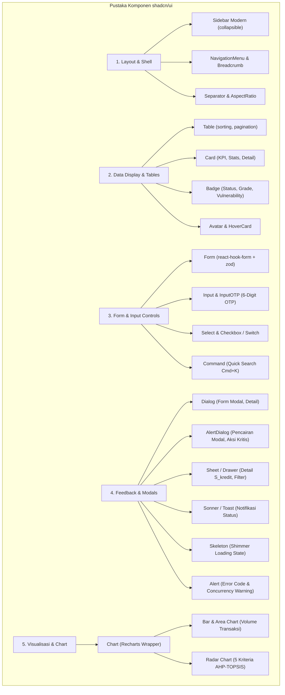
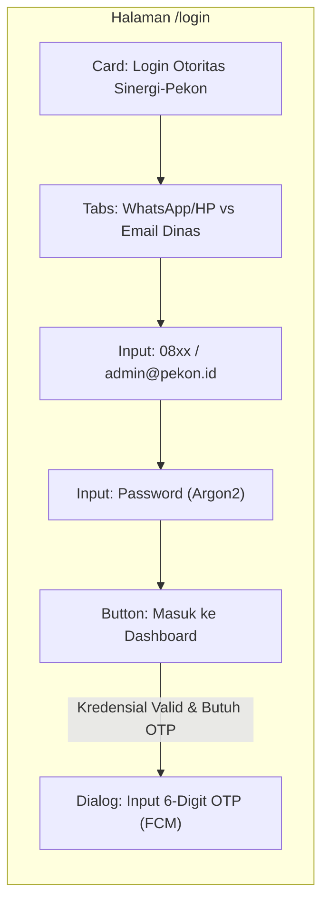
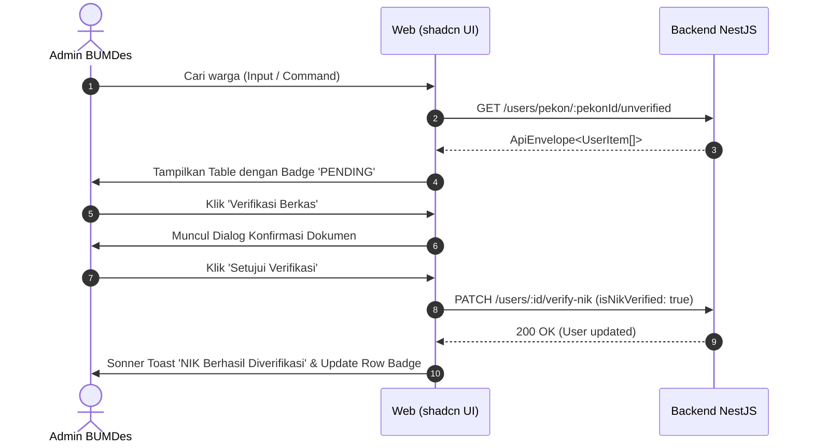
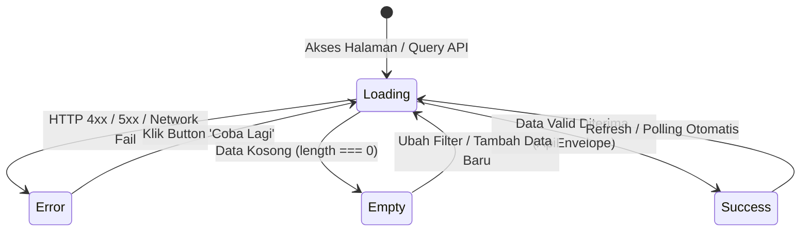

# Master Blueprint: Pemetaan & Perencanaan Desain Halaman Web (100% shadcn/ui)
## Proyek: JEJARING-SEWU (SINERGI-PEKON) / KompasIptek Pringsewu

> **Subproject:** `Web/` (Next.js 14 App Router, Tailwind CSS, TypeScript)  
> **Target Pengguna:** Otoritas Pekon/Desa (`ADMIN_BUMDES`), Pemkab/Perencana Daerah (`ADMIN_BAPPERIDA`), Administrator Global (`SUPER_ADMIN`), serta Warga/UMKM (Portal PWA).  
> **Prinsip Utama:** 100% Full Komponen shadcn/ui, Zero-Trust Security, Strict API Envelope, Aksesibilitas WCAG 2.1 AA.

---

## 1. Inventaris & Taksonomi Komponen shadcn/ui

Untuk memastikan antarmuka konsisten, modular, dan bebas dari dependensi UI pihak ketiga yang acak, seluruh elemen antarmuka dikelompokkan ke dalam kategori pustaka **shadcn/ui** berbasis Radix UI Primitives:



### Tabel Status Pustaka Komponen di `Web/src/components/ui/`

| Komponen shadcn/ui | Status Saat Ini | Kebutuhan Halaman | Dependensi Primitif Radix |
| :--- | :---: | :--- | :--- |
| `button.tsx` | ✅ Terpasang | Seluruh Halaman (CTA, Submit, Action) | `@radix-ui/react-slot` |
| `card.tsx` | ✅ Terpasang | KPI Metrics, Kontainer Halaman, Profil | Native HTML + CVA |
| `badge.tsx` | ✅ Terpasang | Status Transaksi, NIK, Grade A/B/C | CVA |
| `table.tsx` | ✅ Terpasang | Verifikasi NIK, Daftar Kredit, Audit Log | Native HTML Table |
| `dialog.tsx` | ✅ Terpasang | Modal Verifikasi Dokumen, Review Poin | `@radix-ui/react-dialog` |
| `input.tsx` | ✅ Terpasang | Input Text, Pencarian, Login | Native HTML Input |
| **`alert-dialog.tsx`** | ⏳ *Perlu Ditambahkan* | Konfirmasi Pencairan Modal Rp1.5M, Tolak NIK | `@radix-ui/react-alert-dialog` |
| **`sheet.tsx`** | ⏳ *Perlu Ditambahkan* | Drawer Detail 5 Pilar $S_{kredit}$, Forensik Audit | `@radix-ui/react-dialog` |
| **`tabs.tsx`** | ⏳ *Perlu Ditambahkan* | Tab Analitik BAPPERIDA, Switch Peta Tematik | `@radix-ui/react-tabs` |
| **`select.tsx`** | ⏳ *Perlu Ditambahkan* | Filter Pekon, Filter Status, Role Selector | `@radix-ui/react-select` |
| **`input-otp.tsx`** | ⏳ *Perlu Ditambahkan* | Form 6-Digit OTP Login / Reset Password | `input-otp` |
| **`chart.tsx`** | ⏳ *Perlu Ditambahkan* | Area Chart Tren Ekonomi & Radar SPK | `recharts` (sudah terpasang) |
| **`skeleton.tsx`** | ⏳ *Perlu Ditambahkan* | Loading Shimmer Seluruh Halaman Data | Native HTML + Tailwind Animate |
| **`alert.tsx`** | ⏳ *Perlu Ditambahkan* | Banner Error Code Backend (`409`, `429`, `422`) | CVA |
| **`dropdown-menu.tsx`** | ⏳ *Perlu Ditambahkan* | Aksi Baris Tabel, User Profile Topbar | `@radix-ui/react-dropdown-menu` |
| **`sonner.tsx`** | ⏳ *Perlu Ditambahkan* | Notifikasi Transaksi & Feedback API Asinkron | `sonner` |
| **`command.tsx`** | ⏳ *Perlu Ditambahkan* | Quick Search Command Palette (`Ctrl+K`) | `cmdk` |
| **`progress.tsx`** | ⏳ *Perlu Ditambahkan* | Bar Indikator Stok Gizi & Skor Kredit | `@radix-ui/react-progress` |
| **`separator.tsx`** | ⏳ *Perlu Ditambahkan* | Garis Pemisah Visual Modular | `@radix-ui/react-separator` |
| **`tooltip.tsx`** | ⏳ *Perlu Ditambahkan* | Penjelas Rumus AHP & Status Enkripsi AES-256 | `@radix-ui/react-tooltip` |

---

## 2. Pemetaan Desain Halaman per Halaman (Page-by-Page Architectural Mapping)

### 2.1 Halaman Autentikasi: Login Otoritas & OTP (`/login`)

* **Target Persona & Role:** `ADMIN_BUMDES`, `ADMIN_BAPPERIDA`, `SUPER_ADMIN`.
* **Kontrak Backend:** `POST /api/v1/auth/login`, `POST /api/v1/auth/verify-otp`.
* **Pola Zero-Trust:** Access Token disimpan di memori, Refresh Token disimpan otomatis di HttpOnly Cookie `jejaring_pringsewu`.



#### Komponen shadcn/ui yang Digunakan:
1. **`Card`**, **`CardHeader`**, **`CardContent`**, **`CardFooter`**: Wadah kartu login terpusat dengan latar belakang *surface-1* (`#0D1315`) dan border glow mint.
2. **`Tabs`**, **`TabsList`**, **`TabsTrigger`**: Pemilih mode input antara `Nomor WhatsApp/HP` (warga/pengurus desa) dan `Email Resmi Dinas` (BAPPERIDA/Inspektorat).
3. **`Input`**: Field identifier dan kata sandi dengan ikon `Phone` / `Mail` dan `Lock` dari `lucide-react`.
4. **`Button`**: Tombol CTA dengan `variant="default"` (warna mint/emerald), dilengkapi status `disabled` dan ikon spinner saat asinkron.
5. **`Dialog`** + **`InputOTP`**: Modal pop-up yang muncul jika perangkat belum terikat, menerima 6 kotak digit OTP (`InputOTPSlot`).
6. **`Alert`** + **`AlertDescription`**: Notifikasi kesalahan jika backend melempar `ERR_AUTH_INVALID_CREDENTIALS` (401) atau `ERR_RATE_LIMIT_EXCEEDED` (429) dengan penunjuk cooldown waktu.

---

### 2.2 Dashboard BUMDes: Overview Operasional Pekon (`/bumdes/overview`)

* **Target Persona:** Direktur & Pengurus BUMDes.
* **Cakupan Data:** Terikat ketat pada 1 Pekon (`pekonId` dari token sesi login).
* **Kontrak Backend:** `GET /api/v1/credit-scoring/pekon/:pekonId`, `GET /api/v1/transactions`, `GET /api/v1/nutrition/packages`.

```text
┌────────────────────────────────────────────────────────────────────────────────────────┐
│ TOPBAR: Nama Pekon (Badge), Profil BUMDes, Notifikasi Transaksi Baru                  │
├────────────────────────────────────────────────────────────────────────────────────────┤
│ KPI SUMMARY (4 Grid Columns):                                                          │
│ ┌──────────────────┐ ┌──────────────────┐ ┌──────────────────┐ ┌─────────────────────┐ │
│ │ Card: Warga      │ │ Card: Transaksi  │ │ Card: Rekomendasi│ │ Card: Stok Gizi     │ │
│ │ 1.420 Terdaftar  │ │ Rp 48.500.000    │ │ 14 Warga Grade A │ │ 85 Paket Tersedia   │ │
│ │ Badge: 98% NIK Ok│ │ Badge: +12% mg   │ │ Badge: Menunggu  │ │ Progress: 68%       │ │
│ └──────────────────┘ └──────────────────┘ └──────────────────┘ └─────────────────────┘ │
├────────────────────────────────────────────────────┬───────────────────────────────────┤
│ GRAFIK SIRKULASI EKONOMI PEKON                     │ AKSI CEPAT & ANTRIAN KRITIS       │
│ [Chart: Area Chart Perputaran Mingguan Hasil Bumi, │ ┌───────────────────────────────┐ │
│  Jastip, dan Upah Mini-Job]                        │ │ Alert: 3 Pengajuan Modal Baru │ │
│                                                    │ │ Button: Review Grade A        │ │
│                                                    │ ├───────────────────────────────┤ │
│                                                    │ │ Alert: 5 NIK Belum Verifikasi │ │
│                                                    │ │ Button: Buka Verifikasi NIK   │ │
│                                                    │ └───────────────────────────────┘ │
├────────────────────────────────────────────────────┴───────────────────────────────────┤
│ TABEL 10 TRANSAKSI TERAKHIR DENGAN SELFIE PROOF-OF-WORK                                │
│ [Table: ID Transaksi | Modul | Warga | Nominal/Poin | Status Geotag PoW | Aksi Review]  │
└────────────────────────────────────────────────────────────────────────────────────────┘
```

#### Komponen shadcn/ui yang Digunakan:
1. **`Card`** (4 buah): Menampilkan ringkasan metrik utama dengan variasi border mint tipis.
2. **`Badge`**: Memberikan label status visual: `variant="outline"` untuk NIK, `variant="default"` untuk Grade A, dan `variant="destructive"` untuk transaksi pending.
3. **`Chart`** (`AreaChart`): Menampilkan tren perputaran nilai ekonomi 3 pilar (Hasil Bumi, Jastip, Mini-Job) dengan warna token desain.
4. **`Table`**: Menampilkan 10 transaksi sirkular terakhir.
5. **`Skeleton`**: Menampilkan *skeleton placeholder* berbentuk kartu dan baris tabel saat memuat data dari NestJS.
6. **`DropdownMenu`**: Tombol aksi baris tabel untuk melihat detail audit atau foto bukti PoW.

---

### 2.3 Dashboard BUMDes: Verifikasi NIK Warga (`/bumdes/verifikasi-nik`)

* **Target Persona:** Petugas Lapangan & Admin BUMDes.
* **Aturan Bisnis:** 
  * Warga mendaftar dengan NIK. Di backend, data disimpan ganda: `nikHash` (SHA-256) untuk kueri unik dan `nikEncrypted` (AES-256-GCM) untuk perlindungan data privasi.
  * Admin BUMDes memverifikasi kesesuaian fisik KTP/KK dengan akun terdaftar di sistem.
  * Frontend wajib melakukan *masking* pada tampilan (`180104******0002`).
* **Kontrak Backend:** `GET /api/v1/users/pekon/:pekonId/unverified`, `PATCH /api/v1/users/:id/verify-nik`.



#### Komponen shadcn/ui yang Digunakan:
1. **`Input`** + **`Command`**: Kolom filter instan berdasarkan nama warga atau nomor WhatsApp.
2. **`Select`**, **`SelectTrigger`**, **`SelectContent`**, **`SelectItem`**: Dropdown filter status (`Semua`, `Belum Verifikasi`, `Terverifikasi`).
3. **`Table`**, **`TableHeader`**, **`TableRow`**, **`TableCell`**: Tabel berisi kolom:
   * Nama Warga & Nomor WhatsApp terdaftar.
   * NIK Ter-masking (`180104******0002`).
   * Dusun / RT.
   * Tanggal Registrasi.
   * Status Verifikasi (Badge).
   * Aksi Tombol.
4. **`Dialog`**, **`DialogContent`**, **`DialogHeader`**, **`DialogFooter`**: Modal pengecekan dokumen fisik dengan konfirmasi kecocokan berkas kependudukan.
5. **`AlertDialog`**: Dialog peringatan keras saat menolak verifikasi NIK (disertai `Textarea` alasan penolakan).
6. **`Tooltip`**: Menampilkan informasi keamanan bahwa NIK dienkripsi menggunakan AES-256-GCM standar institusi perbankan.

---

### 2.4 Dashboard BUMDes: Rekomendasi & Pencairan Pinjaman Modal (`/bumdes/pinjaman-modal`)

* **Target Persona:** Komite Pinjaman Modal BUMDes & Direktur.
* **Aturan Bisnis & Logika Domain:**
  * Warga yang memiliki skor hasil komputasi SPK AHP-TOPSIS $S_{kredit} \ge 85$ diklasifikasikan sebagai **`GRADE_A_LAYAK_MODAL`**.
  * Plafon standar: **Rp1.500.000 tanpa agunan fisik**.
  * Aksi pencairan wajib bersifat **Atomic Interactive Transaction** di backend, mencatat *Double-Entry Ledger* dan mengirimkan header `X-Idempotency-Key` untuk mencegah klik ganda.
* **Kontrak Backend:** `GET /api/v1/credit-scoring/loans/eligible`, `PATCH /api/v1/credit-scoring/loans/:id/approve`.

#### Komponen shadcn/ui yang Digunakan:
1. **`Card`** (Statistika Alokasi Dana): Total Dana Bergulir BUMDes, Dana Tersalurkan, dan Dana Siap Salur.
2. **`Table`**: Daftar warga yang memenuhi syarat, menampilkan:
   * Nama Peminjam & Usaha Mikro / Aktivitas Jastip.
   * Nilai Skor Kredit ($S_{kredit}$).
   * Plafon Rekomendasi (Rp 1.500.000).
   * Tanggal Terkualifikasi.
   * Tombol Aksi: "Detail Skor" dan "Cairkan Modal".
3. **`Sheet`** (Side Drawer Kanan): Muncul saat tombol "Detail Skor" diklik:
   * Menampilkan **`Chart` (Radar Chart)** yang memvisualisasikan 5 komponen pembentuk skor:
     1. $N_{jastip}$ (Volume Antar Jastip)
     2. $N_{minijob}$ (Penyelesaian Mini-Job)
     3. $N_{hasilbumi}$ (Penjualan Hasil Bumi)
     4. $V_{selfie}$ (Integritas Bukti Selfie PoW)
     5. $I_{inklusi}$ (Keterlibatan Kelompok Rentan/Disabilitas)
   * Dilengkapi daftar transaksi pendukung di buku besar.
4. **`AlertDialog`** (Modal Aksi Kritis Finansial):
   * Berisi konfirmasi persetujuan pencairan modal Rp1.500.000.
   * Menampilkan peringatan bahwa aksi ini akan mencatat entri permanen di `LedgerEntry` dan mengirim notifikasi push FCM ke perangkat warga.
   * Tombol submit dilengkapi *loading state* dan proteksi *disabled* instan.
5. **`Sonner`**: Menampilkan notifikasi *toast* sukses pencairan lengkap dengan ID Transaksi Buku Besar.

---

### 2.5 Dashboard BUMDes: Pengelolaan Paket Pangan Stunting (`/bumdes/gizi-stunting`)

* **Target Persona:** Koordinator Unit Sosial & Pangan BUMDes.
* **Aturan Bisnis:** 
  * Poin reputasi yang didapat warga dari aktivitas ekonomi dapat ditukarkan dengan **Paket Gizi Lokal** (telur segar, ikan lele/nila pekon, sayuran organik) untuk keluarga dengan balita berisiko stunting.
* **Kontrak Backend:** `GET /api/v1/nutrition/packages`, `POST /api/v1/nutrition/packages` (tambah/update stok).

#### Komponen shadcn/ui yang Digunakan:
1. **`Card`** (Grid Katalog Paket): Menampilkan kartu masing-masing paket:
   * Foto komoditas pangan (`AspectRatio`).
   * Nama paket (contoh: *Paket Protein Unggul Pekon A*).
   * Nilai penukaran poin (contoh: *150 Poin Gizi*).
   * Indikator stok tersedia vs terpakai.
2. **`Progress`**: Bar persentase ketersediaan stok fisik di gudang BUMDes.
3. **`Dialog`** + **`Form`**: Modal untuk menambah paket pangan baru dari panen bursa lokal warga atau menambah kuota stok mingguan.
4. **`Table`**: Riwayat penukaran paket gizi oleh warga, status verifikasi pengambilan paket di kantor pekon, dan verifikasi identitas balita.

---

### 2.6 Dashboard BAPPERIDA: Overview Analitik Makro Pringsewu (`/bapperida/overview`)

* **Target Persona:** Kepala BAPPERIDA, Kabid Litbang, dan Tim Perencana Daerah.
* **Cakupan Data:** Makro lintas 126+ Pekon di 9 Kecamatan Kabupaten Pringsewu.
* **Prinsip Keamanan:** Agregasi data murni, tidak ada PII mentah (NIK atau nomor HP pribadi) yang diekspos di level kabupaten.

#### Komponen shadcn/ui yang Digunakan:
1. **`Card`** (Statistik Utama Kabupaten):
   * Total Perputaran Ekonomi Sirkular (Rp).
   * Indeks Partisipasi Inklusi Disabilitas (%).
   * Akumulasi Modal BUMDes Tersalurkan Tanpa Kredit Macet (%).
   * Estimasi Penurunan Risiko Balita Stunting dari Intervensi Poin (Jiwa).
2. **`Chart`** (`BarChart` & `LineChart`):
   * Perbandingan aktivitas ekonomi sirkular antarkecamatan (Gadingrejo, Ambarawa, Pardasuka, Sukoharjo, Pringsewu, Pagelaran, Banyumas, Adiluwih, Pagelaran Utara).
   * Grafik tren bulanan penyerapan hasil bumi lokal.
3. **`Select`**: Dropdown pemilihan tahun anggaran dan kuartal evaluasi RPJMD.
4. **`Table`**: Peringkat Pekon Mandiri dengan aktivitas ekonomi sirkular dan skor ketahanan sosial tertinggi.

---

### 2.7 Dashboard BAPPERIDA: Peta Tematik Geospasial Pekon (`/bapperida/peta-pekon`)

* **Target Persona:** Perencana Tata Ruang & Analis Kebijakan BAPPERIDA.
* **Integrasi Teknis:** Komponen Leaflet (`react-leaflet`) yang dibungkus dalam arsitektur kontainer shadcn/ui.
* **Layer Geospasial:**
  1. *Layer 1 (Batas Administrasi):* Polygon PostGIS batas desa/pekon.
  2. *Layer 2 (Koridor Komuter):* Garis rute kurir jastip pekon-ke-pasar (`LineString`).
  3. *Layer 3 (Klaster Stunting & Gizi):* Sebaran titik keluarga intervensi nutrisi.

#### Komponen shadcn/ui yang Digunakan:
1. **`Card`**: Frame pembungkus peta layar penuh dengan kontrol z-index yang teratur.
2. **`Sheet`** (Drawer Kontrol Layer Melayang):
   * Tombol aktivasi layer menggunakan **`Switch`** (`Layer Bursa Panen`, `Layer Rute Jastip`, `Layer Intervensi Stunting`).
   * Penggeser **`Slider`** untuk mengatur transparansi polygon atau radius kilometer ($r$).
3. **`Tabs`**: Pengubah mode peta cepat: `Peta Ekonomi Sirkular` vs `Peta Kerentanan Gizi/Stunting`.
4. **`Popover`** & **`HoverCard`**: Menampilkan ringkasan ringkas pekon saat kursor berada di atas polygon tanpa memicu request berat.
5. **`Badge`**: Legenda warna peta (*Choropleth map indicator*).

---

### 2.8 Dashboard BAPPERIDA: Analitik SPK AHP-TOPSIS (`/bapperida/analitik-spk`)

* **Target Persona:** Penilai Kebijakan BAPPERIDA & Inspektorat.
* **Kontrak Domain:** Formula pembobotan kriteria AHP-TOPSIS:
  $$S_{kredit} = (0.20 \cdot N_{jastip}) + (0.25 \cdot N_{minijob}) + (0.20 \cdot N_{hasilbumi}) + (0.20 \cdot V_{selfie}) + (0.15 \cdot I_{inklusi})$$

#### Komponen shadcn/ui yang Digunakan:
1. **`Tabs`**: Membagi tampilan analitik:
   * Tab 1: *Distribusi Skor Kabupaten*
   * Tab 2: *Sensitivitas Matriks AHP*
   * Tab 3: *Evaluasi Dampak Inklusi Disabilitas*
2. **`Chart`** (`RadarChart` & `BarChart`):
   * Visualisasi komparasi multi-kriteria untuk masing-masing kecamatan.
3. **`Table`**: Matriks normalisasi TOPSIS (jarak solusi ideal positif $D^+$ dan solusi ideal negatif $D^-$).
4. **`Tooltip`**: Menampilkan penjelasan matematis rumus AHP-TOPSIS pada masing-masing header kriteria.
5. **`Button`**: Tombol ekspor data laporan analisis komprehensif ke format PDF/Excel resmi BAPPERIDA.

---

### 2.9 Dashboard Otoritas: Audit Trail & Integritas Data (`/bapperida/audit-trail`)

* **Target Persona:** Auditor BAPPERIDA, Inspektorat, dan `SUPER_ADMIN`.
* **Aturan Bisnis:** 
  * Setiap mutasi saldo di `LedgerEntry` wajib memiliki tanda tangan integritas digital `integritySignature` (HMAC-SHA256).
  * Halaman ini memvalidasi keabsahan data tanpa rekayasa database (*tamper-proof audit*).

#### Komponen shadcn/ui yang Digunakan:
1. **`Table`**: Menampilkan log transaksi audit dengan kolom:
   * Waktu Transaksi (Server Timestamp).
   * Modul Transaksi (Bursa Panen, Jastip, Mini-Job, Pinjaman Modal).
   * Entitas Terlibat (ID Samaran / Anonimitas Terlindungi).
   * Mutasi Saldo Kas & Poin (`balanceBefore` ➔ `balanceAfter`).
   * Status Integritas Signature (Badge).
2. **`Badge`**:
   * `INTEGRITY_OK` (Warna hijau dengan ikon gembok terverifikasi).
   * `TAMPER_DETECTED` (Warna merah berkedip jika signature tidak cocok).
3. **`Sheet`** (Detail Forensik Transaksi):
   * Menampilkan payload JSON mentah, User Agent perangkat, alamat IP pencatat, dan kode HMAC-SHA256 lengkap.
4. **`Input`**: Pencarian transaksi berdasarkan hash ID atau nomor rekening buku besar.

---

## 3. Matriks Komponen shadcn/ui per Halaman

| Halaman Route | Layout & Navigasi | Input & Forms | Data Display & Tables | Overlays & Feedback | Charts |
| :--- | :--- | :--- | :--- | :--- | :--- |
| **`/login`** | `Card`, `Tabs` | `Input`, `Form`, `InputOTP` | `Badge` | `Alert`, `Dialog` | - |
| **`/bumdes/overview`** | `Sidebar`, `Topbar` | `DropdownMenu` | `Card`, `Badge`, `Table` | `Skeleton` | `AreaChart` |
| **`/bumdes/verifikasi-nik`** | `Sidebar`, `Topbar` | `Input`, `Select`, `Command` | `Table`, `Badge` | `Dialog`, `AlertDialog`, `Tooltip`, `Sonner` | - |
| **`/bumdes/pinjaman-modal`** | `Sidebar`, `Topbar` | `Select` | `Card`, `Table`, `Badge` | `Sheet`, `AlertDialog`, `Sonner`, `Skeleton` | `RadarChart` |
| **`/bumdes/gizi-stunting`** | `Sidebar`, `Topbar` | `Form`, `Input`, `Select` | `Card`, `Progress`, `Table` | `Dialog`, `AlertDialog`, `Sonner` | `BarChart` |
| **`/bapperida/overview`** | `Sidebar`, `Topbar` | `Select`, `DropdownMenu` | `Card`, `Badge`, `Table` | `Skeleton` | `BarChart`, `AreaChart` |
| **`/bapperida/peta-pekon`** | `Card` (Map Frame) | `Switch`, `Slider` | `Badge` | `Sheet`, `Popover`, `HoverCard` | - |
| **`/bapperida/analitik-spk`**| `Sidebar`, `Topbar` | `Tabs` | `Table`, `Badge` | `Tooltip`, `Sheet` | `RadarChart`, `BarChart` |
| **`/bapperida/audit-trail`** | `Sidebar`, `Topbar` | `Input`, `Select` | `Table`, `Badge` | `Sheet`, `Alert`, `Tooltip` | - |

---

## 4. Standar State Machine UI (WCAG 2.1 AA & Zero-Trust)

Setiap halaman yang mengonsumsi API backend NestJS wajib mengimplementasikan **4 status antarmuka** menggunakan komponen shadcn/ui:



1. **State `Loading`**:
   * Dilarang menggunakan spinner layar penuh polos (*blank screen*).
   * Wajib menggunakan **`Skeleton`** yang membentuk siluet kartu, grafik, dan baris tabel yang akan muncul.
2. **State `Empty`**:
   * Menggunakan **`Card`** dengan ikon `lucide-react` tematik, pesan penjelasan ramah warga desa, dan tombol CTA (contoh: *"Belum ada pengajuan pinjaman modal Grade A minggu ini"*).
3. **State `Error`**:
   * Menampilkan **`Alert`** dengan varian `destructive`.
   * Memetakan kode kesalahan backend (`ERR_CONCURRENCY_LOCK`, `ERR_RATE_LIMIT_EXCEEDED`, `ERR_FORBIDDEN_ROLE_ACCESS`) ke dalam bahasa Indonesia yang mudah dipahami petugas desa.
   * Menyediakan tombol **`Button`** `variant="outline"` untuk melakukan *retry* manual.
4. **State `Success`**:
   * Merender komponen tabel/kartu interaktif.
   * Setiap mutasi sukses (pencairan dana, verifikasi NIK) wajib memicu **`Sonner`** toast dengan penanda waktu eksekusi.

---

## 5. Rencana Instalasi Paket & Eksekusi Bertahap

Untuk melengkapi komponen shadcn/ui yang belum terpasang di folder `Web/`:

### Tahap 1: Instalasi Primitif Radix UI yang Dibutuhkan
Jalankan di subdirektori `Web/`:
```bash
npm install @radix-ui/react-alert-dialog @radix-ui/react-tabs @radix-ui/react-select @radix-ui/react-dropdown-menu @radix-ui/react-popover @radix-ui/react-tooltip @radix-ui/react-separator @radix-ui/react-progress @radix-ui/react-switch @radix-ui/react-slider @radix-ui/react-scroll-area input-otp sonner cmdk react-hook-form @hookform/resolvers zod
```

### Tahap 2: Pembuatan Komponen shadcn/ui Baru
Tambahkan komponen berikut ke dalam folder `Web/src/components/ui/`:
1. `alert-dialog.tsx`
2. `sheet.tsx`
3. `tabs.tsx`
4. `select.tsx`
5. `input-otp.tsx`
6. `chart.tsx`
7. `skeleton.tsx`
8. `alert.tsx`
9. `dropdown-menu.tsx`
10. `sonner.tsx`
11. `progress.tsx`
12. `tooltip.tsx`

### Tahap 3: Refactoring Halaman Bertahap (Sprint Execution)
1. **Sprint 1 (Auth & BUMDes Core):** Refactor `/login`, `/bumdes/overview`, dan `/bumdes/verifikasi-nik` menggunakan Form Zod + Table + Dialog.
2. **Sprint 2 (Finansial & Stunting):** Implementasikan `/bumdes/pinjaman-modal` (AlertDialog + Sheet Radar) dan `/bumdes/gizi-stunting`.
3. **Sprint 3 (BAPPERIDA Makro & Audit):** Implementasikan `/bapperida/overview`, `/bapperida/analitik-spk`, dan `/bapperida/audit-trail`.
4. **Sprint 4 (Geospasial):** Sempurnakan integrasi Leaflet di `/bapperida/peta-pekon` dengan Sheet filter layer.
