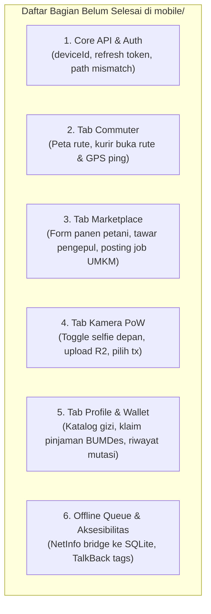
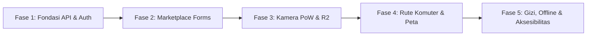

# PRODUCT REQUIREMENTS DOCUMENT (PRD) & TASK BREAKDOWN
**Penyelesaian Aplikasi Mobile: JEJARING-SEWU (SINERGI-PEKON)**  
*React Native Expo Client — Kabupaten Pringsewu*

---

## 1. Daftar Bagian yang Belum Selesai (Current Gap Analysis)

Berikut adalah inventarisasi lengkap fitur dan komponen yang saat ini **belum selesai** atau **masih berupa mock/simulasi** di folder `mobile/`:

### Rincian per Modul:

1. **Core Network & Autentikasi (`mobile/services/` & `mobile/context/`):**
   * ❌ **Login Payload:** `AuthContext.tsx` belum menyertakan `deviceId`, sehingga ditolak HTTP 400 oleh backend.
   * ❌ **Refresh Token Flow:** Mobile membaca `refreshToken` dari JSON body yang saat ini tidak dikirimkan oleh backend (backend menggunakan cookie `HttpOnly`).
   * ❌ **Sinkronisasi Path Endpoint:** 10+ pemanggilan API menggunakan path yang keliru (`/commuter/*` vs `/commuters/*`, `/transactions/my` vs `/transactions/me`, dll).
   * ❌ **Offline Queue Unconnected:** `sqlite.service.ts` sudah ada tetapi belum dihubungkan ke aksi transaksi di antarmuka (UI).

2. **Tab 1: Logistik Komuter Jastip (`commuter.tsx`):**
   * ❌ **Visualisasi Peta Geospasial:** Belum ada peta rute asal-tujuan (Pekon Pagelaran s.d. Pasar Pringsewu).
   * ❌ **Mode Pengemudi / Kurir Warga:** Warga hanya bisa memesan titipan jastip. Belum ada tombol dan form bagi kurir untuk **Membuka Rute** (`POST /commuters/routes/start`) atau **Memperbarui Lokasi GPS** (`PATCH /commuters/routes/:id/ping`).
   * ❌ **Form Titip Jastip:** Masih menggunakan `Alert.prompt` bawaan iOS dengan koordinat lat/lng dan ongkos patungan bensin Rp 7.500 yang di-hardcode.

3. **Tab 2: Bursa Panen & Mini-Job (`marketplace.tsx`):**
   * ❌ **Form Posting Panen Petani:** Petani desa belum memiliki modal/form untuk membuat lelang hasil bumi baru (`POST /harvests/listings`).
   * ❌ **Aksi Tawar Harga Pengepul:** Tombol "Tawar Harga" masih berupa `Alert.alert` dummy; belum ada modal input harga per kg (`POST /harvests/listings/:id/bids`).
   * ❌ **Persetujuan Lelang Panen:** Petani belum memiliki tampilan untuk melihat daftar tawaran pengepul yang masuk dan menguncinya (`POST /harvests/bids/:bidId/accept`).
   * ❌ **Posting Lowongan Mini-Job UMKM:** Pelaku usaha desa belum memiliki form untuk membuka pekerjaan mikro harian (`POST /mini-jobs`).
   * ❌ **Header Idempotency:** Header `x-idempotency-key` masih dikirim di dalam body JSON, bukan di HTTP headers.

4. **Tab 3: Kamera Validasi Selfie PoW (`verify-camera.tsx`):**
   * ❌ **Toggle Kamera Depan/Belakang:** Kamera terkunci di `facing="back"`. Pengguna tidak bisa selfie wajah bersama objek kerja.
   * ❌ **Pemilih Transaksi Aktif:** Sistem hanya mengambil transaksi pertama; jika pekerja memiliki beberapa tugas, tidak ada opsi untuk memilih tugas mana yang dibuktikan.
   * ❌ **Penyimpanan Gambar Nyata:** Masih menggunakan URL tiruan `mock-storage.pekon.id` dan belum mengunggah gambar biner ke cloud storage.

5. **Tab 4: Dompet & Skor Kredit BUMDes (`profile-wallet.tsx`):**
   * ❌ **Katalog Intervensi Stunting:** Tombol "Buka Katalog Pangan Gizi" hanya alert statis; belum memuat paket gizi dari `GET /nutrition/packages` dan aksi tebus poin `POST /nutrition/redeem`.
   * ❌ **Plafon Pinjaman Modal BUMDes:** Tombol klaim Rp 1.500.000 hanya menampilkan alert statis.
   * ❌ **Buku Besar / Riwayat Mutasi Dompet:** Belum ada daftar riwayat kredit/debit mutasi saldo tunai dan poin reputasi (`LedgerEntry`).

6. **Aksesibilitas (Zero-Discrimination Standard):**
   * ❌ Belum ada atribut `accessible={true}`, `accessibilityLabel`, atau `accessibilityRole` pada tombol-tombol utama untuk mendukung pembaca layar tunanetra (TalkBack).

---

## 2. Product Requirements Document (PRD)

### 2.1 Tujuan Produk
Menyelesaikan aplikasi mobile *client* berbasis React Native Expo agar berfungsi penuh secara *offline-first* dan terintegrasi mulus dengan backend NestJS, melayani warga desa (petani, buruh mini-job disabilitas/lansia, komuter, dan keluarga balita) di Kabupaten Pringsewu.

### 2.2 Target Pengguna & Persona
1. **Pak Slamet (Petani Pekon):** Ingin memposting panen singkong 2 ton dan menerima tawaran harga wajar tanpa potongan tengkulak.
2. **H. Suratno (Pengepul Terpercaya):** Ingin memantau panen terbuka di pekon dan mengajukan penawaran harga beli per kg.
3. **Mbak Yanti (Pekerja Mini-Job Disabilitas):** Ingin mengunci pekerjaan mikro (kupas singkong/kemas gula aren) tanpa diskriminasi seleksi fisik dan memverifikasi hasil kerja via Selfie PoW.
4. **Mas Dedi (Kurir Komuter Searah):** Tiap pagi berangkat dari Pagelaran ke Pasar Pringsewu, ingin berbagi bagasi motor untuk titipan barang warga dengan patungan bensin.
5. **Ibu Siti (Keluarga Balita Risiko Stunting):** Menukarkan poin reputasi kerja dengan paket telur bebek dan ikan nila segar di BUMDes.

### 2.3 Matriks Kontrak Integrasi REST API

| Fitur Mobile | Method | Endpoint Backend Asli | Payload / Parameter Kunci |
| :--- | :--- | :--- | :--- |
| **Login Sesi** | `POST` | `/api/v1/auth/login` | `{ identifier, password, deviceId }` |
| **Profil Warga** | `GET` | `/api/v1/users/me` | *Header Authorization: Bearer JWT* |
| **Rute Komuter Aktif** | `GET` | `/api/v1/commuters/routes/nearby` | `?lat=-5.3421&lng=104.9452&radiusMeters=10000` |
| **Buka Rute Kurir** | `POST` | `/api/v1/commuters/routes/start` | `{ originName, destinationName, originLat, originLng, destLat, destLng }` |
| **Ping GPS Rute** | `PATCH` | `/api/v1/commuters/routes/:id/ping` | `{ currentLat, currentLng }` |
| **Pesan Jastip** | `POST` | `/api/v1/commuters/routes/:id/orders` | `{ itemDescription, fuelShareCost, pickupLat, pickupLng }` |
| **Feed Mini-Job** | `GET` | `/api/v1/mini-jobs` | `?status=OPEN` |
| **Klaim Mini-Job** | `POST` | `/api/v1/mini-jobs/:id/claim` | *Header: `x-idempotency-key`* |
| **Posting Mini-Job** | `POST` | `/api/v1/mini-jobs` | `{ title, description, wageAmount, isDisabilityFriendly }` |
| **Feed Hasil Panen** | `GET` | `/api/v1/harvests/listings` | `?status=OPEN_BIDDING` |
| **Posting Panen** | `POST` | `/api/v1/harvests/listings` | `{ commodityName, estimatedKg, minPricePerKg }` |
| **Tawar Panen** | `POST` | `/api/v1/harvests/listings/:id/bids` | `{ offeredPricePerKg, referralUsedCode }` |
| **Kunci Lelang Panen** | `POST` | `/api/v1/harvests/bids/:bidId/accept` | *Header: `x-idempotency-key`* |
| **Transaksi Aktif Saya** | `GET` | `/api/v1/transactions/me` | `?status=IN_PROGRESS` |
| **Kirim Selfie PoW** | `POST` | `/api/v1/transactions/:id/selfie-pow`| `{ imageStorageUrl, imageSha256Hash, gpsLatitude, gpsLongitude, gpsAccuracyMeters, pekonNameOverlay, isCameraDirect }` |
| **Dompet & Ledger** | `GET` | `/api/v1/wallets/me` | Return `cashBalance`, `pointsBalance`, `ledgerEntries` |
| **Skor Kredit SPK** | `GET` | `/api/v1/credit-scoring/me` | Return `$S_{kredit}$`, grade, rincian 5 variabel |
| **Katalog Paket Gizi** | `GET` | `/api/v1/nutrition/packages` | List paket bahan pangan pekon |
| **Tukar Paket Gizi** | `POST` | `/api/v1/nutrition/redeem` | `{ packageId }` |

---

## 3. Work Breakdown Structure & Implementation Tasks

Pengerjaan dibagi ke dalam **5 Fase Terstruktur** yang berurutan dan aman dari risiko *breaking change*:

---

### FASE 1: Fondasi API & Autentikasi (Prioritas #1)
> **Tujuan:** Menjadikan komunikasi mobile ke backend 100% bebas dari HTTP 400 dan HTTP 404.

- [x] **Task 1.1:** Tambahkan `deviceId: string` pada `mobile/context/AuthContext.tsx` menggunakan `expo-crypto` (`Crypto.randomUUID()`) agar lolos `LoginDto` backend.
- [x] **Task 1.2:** Sesuaikan `Backend/src/features/auth/auth.controller.ts` agar menyertakan `refreshToken` pada JSON response body login selain cookie `HttpOnly`, sehingga klien native Expo dapat menyimpannya di `SecureStore`.
- [x] **Task 1.3:** Selaraskan seluruh URL pemanggilan di `mobile/services/api.ts` dan layar-layar tab:
  - Ubah `/commuter/*` ➔ `/commuters/*`
  - Ubah `/transactions/my` ➔ `/transactions/me`
  - Ubah `/wallets/my` ➔ `/wallets/me`
  - Ubah `/credit-scoring/my-score` ➔ `/credit-scoring/me`
- [x] **Task 1.4:** Perbaiki pengiriman `x-idempotency-key` pada klaim mini-job dari body JSON menjadi HTTP Request Header.

---

### FASE 2: Form Transaksi Nyata pada Marketplace (Prioritas #2)
> **Tujuan:** Menghilangkan seluruh alert simulasi pada bursa panen dan bursa kerja mikro.

- [x] **Task 2.1:** Buat komponen modal **"Posting Hasil Panen"** bagi petani (`commodityName`, `estimatedKg`, `minPricePerKg`).
- [x] **Task 2.2:** Buat komponen modal **"Ajukan Penawaran Pengepul"** (`offeredPricePerKg`, opsional `referralUsedCode`).
- [x] **Task 2.3:** Buat tampilan daftar penawaran masuk pada kartu panen petani beserta tombol **"Terima Tawaran"** (`POST /harvests/bids/:bidId/accept`).
- [x] **Task 2.4:** Buat modal dialog **"Buka Lowongan Kerja Mikro"** bagi pelaku UMKM (`title`, `description`, `wageAmount`, switch `isDisabilityFriendly`).
- [x] **Task 2.5:** Tambahkan filter status (Semua, Ramah Disabilitas, Tersedia) pada Bursa Mini-Job.

---

### FASE 3: Penyempurnaan Kamera Validasi Selfie PoW (Prioritas #3)
> **Tujuan:** Verifikasi bukti kerja fisik yang fleksibel, akurat, dan terhubung ke cloud storage.

- [x] **Task 3.1:** Tambahkan tombol **Flip Camera** (toggle `facing="front"` dan `facing="back"`) pada `verify-camera.tsx`.
- [x] **Task 3.2:** Buat komponen dropdown/daftar kartu **Pemilih Transaksi Aktif** yang berstatus `IN_PROGRESS` atau `AWAITING_SELFIE_POW` sebelum mengambil foto.
- [x] **Task 3.3:** Siapkan presigned upload handler atau fallback binary upload multipart ke endpoint penyimpanan foto Cloudflare R2 / local storage backend.
- [x] **Task 3.4:** Validasi batas toleransi GPS (peringatan jika akurasi GPS > 50 meter agar bukti kerja sah).

---

### FASE 4: Komuter Jastip & Visualisasi Rute Geospasial (Prioritas #4)
> **Tujuan:** Memfungsikan rute perjalanan warga dan visualisasi titik temu.

- [x] **Task 4.1:** Buat tab toggle di layar Commuter: **"Titip Barang (Warga)"** dan **"Buka Rute (Kurir)"**.
- [x] **Task 4.2:** Buat form **"Buka Perjalanan Komuter"** bagi kurir (`originName`, `destinationName`, koordinat asal & tujuan).
- [x] **Task 4.3:** Tambahkan tombol **"Mulai Perjalanan & Broadcast GPS"** yang secara berkala memanggil `PATCH /commuters/routes/:id/ping`.
- [x] **Task 4.4:** Pasang visualisasi peta OpenStreetMap (OSM) via WebView ringan atau rute garis lurus statis titik jemput-antar.
- [x] **Task 4.5:** Perbaiki modal **"Pesan Jastip"** agar mengambil lokasi koordinat GPS penjemputan warga secara real-time.

---

### FASE 5: Dompet, Intervensi Gizi, Offline Queue & Aksesibilitas (Prioritas #5)
> **Tujuan:** Menjamin keandalan di wilayah blank-spot dan inklusivitas penuh bagi kelompok rentan.

- [x] **Task 5.1:** Tampilkan daftar riwayat mutasi buku besar (`LedgerEntry`) di bawah kartu dompet (menampilkan kredit upah dan debit penukaran gizi).
- [x] **Task 5.2:** Buat modal **"Katalog Pangan Bergizi Pekon"** yang mengambil data dinamis `GET /nutrition/packages` dan tombol konfirmasi tukar poin (`POST /nutrition/redeem`).
- [x] **Task 5.3:** Hubungkan seluruh pemanggilan aksi ke `queueOfflineTask` di `sqlite.service.ts` jika `NetInfo` mendeteksi jaringan *offline*.
- [x] **Task 5.4:** Tambahkan banner indikator jaringan di bagian atas aplikasi (Online / Mode Offline dengan jumlah antrean pending).
- [x] **Task 5.5:** Lengkapi seluruh elemen interaktif dengan tag aksesibilitas TalkBack (`accessible={true}`, `accessibilityLabel="Label deskriptif bahasa Indonesia"`).
- [x] **Task 5.6:** Tambahkan pengaturan ukuran font di profil warga untuk kemudahan membaca bagi lansia.

---

## 4. Panduan Eksekusi Teknis

Sesuai aturan `AGENTS.md`:
* **Fokus Subproject:** Seluruh pekerjaan pengerjaan mobile dilakukan di dalam direktori `mobile/`, kecuali Task 1.2 yang membutuhkan penyesuaian minor pada `Backend/src/features/auth/auth.controller.ts`.
* **Prinsip Perubahan:** Lakukan modifikasi bertahap per-task (*surgical edits*), tanpa perombakan struktur yang tidak diperlukan.

