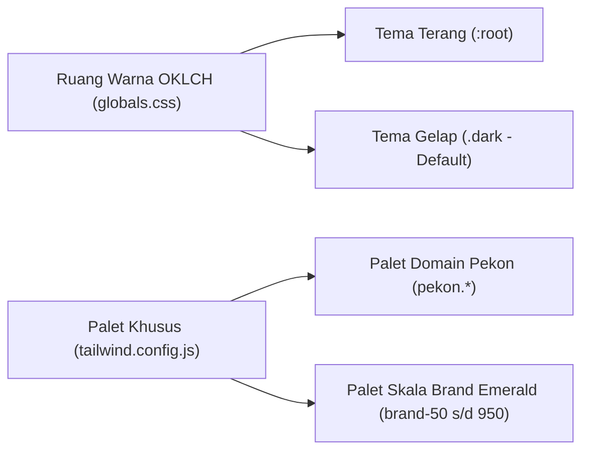
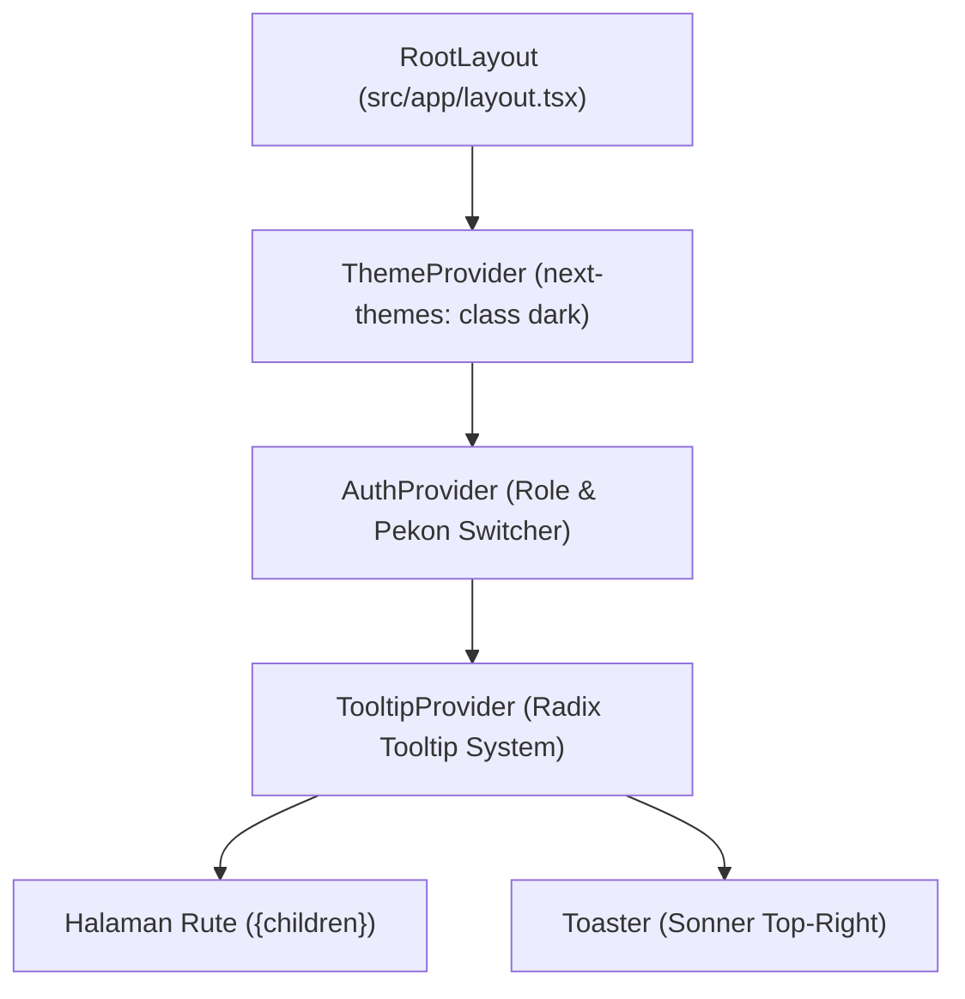

# Sistem Desain Frontend (DESIGN.md)
## Ekosistem Web Dashboard JEJARING-SEWU (SINERGI-PEKON)
**Versi:** 2.0 (Next.js 14 App Router, Tailwind CSS v4, shadcn/ui, Geist Typography)  
**Terakhir Diperbarui:** November 2026  
**Status:** Produksi / Enterprise Standard  

---

## 1. Filosofi & Visi Desain (*Design Philosophy*)

Platform **JEJARING-SEWU** dirancang khusus untuk menjembatani operasional pemerintahan desa (BUMDes), badan perencana daerah (BAPPERIDA), dan partisipasi ekonomi warga pekon di Kabupaten Pringsewu. Antarmuka mengusung filosofi **"Modern Civic Agritech"**:
1. **Presisi Data & Kerapihan Eksekutif:** Menampilkan metrik geospasial, indikator SPK AHP-TOPSIS, dan pembukuan kas desa dengan kontras tajam, bebas distorsi, dan hierarki visual yang jelas.
2. **Keterbacaan Optimal di Seluruh Perangkat:** Menggunakan tipografi modern berketerbacaan tinggi (**Geist Sans** & **Geist Mono**) yang dirancang untuk layar resolusi tinggi maupun perangkat komputasi terjangkau di kantor desa.
3. **Estetika Pedesaan Berkelanjutan (*Pekon Dark Theme*):** Memadukan warna dasar gelap pekat (*deep slate*) dengan aksen hijau neon mint (*emerald/mint*) sebagai perlambang agrikultur modern, kedaulatan pangan, dan ekonomi sirkular desa.
4. **Zero-Trust Visual Feedback:** Setiap aksi kritikal (verifikasi NIK, persetujuan kredit mikro, penebusan paket gizi) memiliki diferensiasi visual status yang tegas (*safe*, *warning*, *destructive*).

---

## 2. Tipografi Resmi (*Typography System*)

Ekosistem Web JEJARING-SEWU mengadopsi keluarga huruf **Geist** dari Vercel sebagai standar baku tipografi antarmuka dan penulisan kode/angka teknis.

```text
Tipografi Web JEJARING-SEWU
├── Geist Sans (var(--font-geist-sans)) ── Antarmuka UI, Judul, Form, Navigasi
└── Geist Mono (var(--font-geist-mono)) ── Angka Finansial, Skor SPK, NIK, Hash, Koordinat GPS
```

### 2.1 Konfigurasi di `layout.tsx`
Font diimpor langsung melalui paket resmi `geist` dengan pemanfaatan CSS variable Next.js:

```tsx
// File: src/app/layout.tsx
import { GeistSans } from "geist/font/sans";
import { GeistMono } from "geist/font/mono";
import { cn } from "@/lib/utils";

export default function RootLayout({ children }: { children: React.ReactNode }) {
  return (
    <html
      lang="id"
      suppressHydrationWarning
      className={cn("font-sans", GeistSans.variable, GeistMono.variable)}
    >
      <body className="antialiased min-h-screen bg-background text-foreground font-sans">
        {/* Provider Hierarchy */}
        {children}
      </body>
    </html>
  );
}
```

### 2.2 Integrasi di `tailwind.config.js`
Tailwind CSS memetakan variabel font ke utilitas kelas `font-sans` dan `font-mono` dengan rantai *fallback* sistem operasi yang kokoh:

```javascript
// File: tailwind.config.js
module.exports = {
  theme: {
    extend: {
      fontFamily: {
        sans: [
          "var(--font-geist-sans)",
          "Geist",
          "Inter",
          "system-ui",
          "-apple-system",
          "BlinkMacSystemFont",
          "'Segoe UI'",
          "Roboto",
          "sans-serif",
        ],
        mono: [
          "var(--font-geist-mono)",
          "Geist Mono",
          "'JetBrains Mono'",
          "ui-monospace",
          "SFMono-Regular",
          "Menlo",
          "Monaco",
          "Consolas",
          "monospace",
        ],
      },
    },
  },
};
```

### 2.3 Deklarasi `@theme` di `globals.css`
Tailwind CSS v4 `@theme inline` mengekspos variabel font untuk memastikan kompatibilitas CSS tingkat rendah (*low-level CSS*):

```css
/* File: src/app/globals.css */
@theme inline {
  --font-sans: var(--font-geist-sans), "Geist", system-ui, -apple-system, sans-serif;
  --font-mono: var(--font-geist-mono), "Geist Mono", monospace;
}
```

### 2.4 Panduan Penggunaan Tipografi (*Type Hierarchy*)

| Skala / Elemen | Kelas Tailwind | Font Family | Bobot (*Weight*) | Kegunaan |
| :--- | :--- | :--- | :--- | :--- |
| **Display / H1** | `text-2xl font-bold tracking-tight md:text-3xl` | Geist Sans | Bold (700) | Judul utama dashboard BUMDes/BAPPERIDA |
| **Section Title / H2** | `text-xl font-semibold` | Geist Sans | Semibold (600) | Header kartu analitik & tabel |
| **Card Header / H3** | `text-base font-medium` | Geist Sans | Medium (500) | Judul submodul, modal dialog |
| **Body Text** | `text-sm text-foreground leading-relaxed` | Geist Sans | Regular (400) | Paragraf, deskripsi tugas, formulir |
| **Muted Text** | `text-xs text-muted-foreground` | Geist Sans | Regular (400) | Label bantuan, timestamp, metadata pekon |
| **Data Finansial** | `text-sm font-mono font-medium tracking-tight` | Geist Mono | Medium (500) | Saldo kas Rp, bobot panen (kg), poin gizi |
| **Skor SPK ($S_{kredit}$)** | `text-lg font-mono font-bold text-primary` | Geist Mono | Bold (700) | Nilai skor 0–100, persentase deviasi |
| **Kripto & Geospasial** | `text-xs font-mono text-muted-foreground` | Geist Mono | Regular (400) | Hash SHA-256, NIK terenkripsi, koordinat GPS |

---

## 3. Sistem Warna & Token (*Color System & Tokens*)

Sistem warna JEJARING-SEWU menggunakan ruang warna gamut tinggi **OKLCH** untuk memastikan persepsi kecerahan seragam (*perceptual uniformity*) di seluruh tema terang dan gelap.



### 3.1 Token Semantik OKLCH (`globals.css`)

#### A. Tema Gelap (`.dark`) — Tema Utama BUMDes & BAPPERIDA
Tema gelap menjadi tampilan *default* untuk mengurangi kelelahan mata operator desa saat bekerja seharian penuh:

| Token CSS | Nilai OKLCH | Padanan Visual | Deskripsi Peruntukan |
| :--- | :--- | :--- | :--- |
| `--background` | `oklch(0.13 0.01 210)` | `#121619` | Latar belakang dasar halaman kanvas |
| `--foreground` | `oklch(0.98 0.005 200)` | `#F4F7F6` | Teks utama dengan kontras tinggi |
| `--card` | `oklch(0.17 0.01 210)` | `#1A2023` | Permukaan kartu (*card*) dan panel kontainer |
| `--card-foreground` | `oklch(0.98 0.005 200)` | `#F4F7F6` | Teks di dalam kartu |
| `--primary` | `oklch(0.78 0.14 165)` | `#00F2A9` | Warna aksen utama (Neon Mint Pekon) |
| `--primary-foreground`| `oklch(0.12 0.02 165)` | `#022B1E` | Teks di atas tombol primer |
| `--secondary` | `oklch(0.22 0.01 210)` | `#22292D` | Tombol sekunder, tag latar belakang |
| `--muted` | `oklch(0.20 0.01 210)` | `#1E2528` | Elemen tidak aktif atau latar belakang input |
| `--muted-foreground` | `oklch(0.68 0.02 210)` | `#9DA8AF` | Teks sekunder, label pembantu, placeholder |
| `--accent` | `oklch(0.24 0.03 175)` | `#1D312A` | Efek *hover* menu dan *active state* |
| `--destructive` | `oklch(0.65 0.22 25)` | `#FF4D4D` | Indikasi bahaya, penolakan, status gagal |
| `--border` | `oklch(0.26 0.02 195 / 35%)` | Transparan 35% | Garis batas tipis berkelas |
| `--ring` | `oklch(0.78 0.14 165)` | `#00F2A9` | Cincin fokus aksesibilitas (*focus-visible*) |

#### B. Tema Terang (`:root`)
Disediakan untuk preferensi pengguna yang menyukai tampilan cerah:

| Token CSS | Nilai OKLCH | Deskripsi |
| :--- | :--- | :--- |
| `--background` | `oklch(0.99 0 0)` | Putih bersih (*Clean Canvas*) |
| `--foreground` | `oklch(0.14 0.01 240)` | Teks hitam kebiruan gelap |
| `--primary` | `oklch(0.68 0.16 165)` | Hijau emerald pekon solid |
| `--border` | `oklch(0.91 0.01 240)` | Garis batas abu-abu lembut |

---

### 3.2 Palet Domain Khusus Pekon (`tailwind.config.js`)

Untuk komponen grafis, peta geospasial, dan lencana identitas desa, tersedia warna paten di namespace `pekon`:

```javascript
pekon: {
  bg: "#0F1416",       // Deep Midnight Agritech Background
  surface: "#151C1E",  // Elevated Dashboard Panel
  card: "#1C2026",     // Interactive Component Card
  border: "#3B4A41",   // Forest Green Subtle Border
  primary: "#00F2A9",  // Vibrant Digital Neon Mint
  mint: "#C1FFDD",     // Soft Highlight Mint
  text: "#DFE2EB",     // Crisp Body Typography
  muted: "#B9CBBF",    // Secondary Sage Green
  subtle: "#84958A",   // Inactive Icon / Breadcrumb Tint
}
```

### 3.3 Palet Skala Brand Emerald (`brand-50` s/d `brand-950`)
Digunakan untuk visualisasi diagram data (Recharts) dan variasi status tingkat risiko stunting:
- `brand-50` s/d `brand-300`: Indikator zona aman pangan desa.
- `brand-500` (`#10b981`): Standar tombol sukses transaksi BUMDes.
- `brand-700` s/d `brand-950`: Gradien panel lateral dan kartu ringkasan eksekutif.

### 3.4 Palet Grafik Chart (`--chart-1` s/d `--chart-5`)
- `--chart-1` (Mint Primary): Volume panen lokal pekon.
- `--chart-2` (Cyan Tech): Frekuensi komuter *Nebeng-Jastip*.
- `--chart-3` (Golden Harvest): Realisasi serapan tenaga kerja disabilitas (*Mini-Job*).
- `--chart-4` (Purple Insight): Distribusi skor kelayakan kredit BUMDes ($S_{kredit}$).
- `--chart-5` (Coral Urgent): Indeks keluarga berisiko stunting balita.

---

## 4. Arsitektur Tata Letak & Provider Hierarchy (`layout.tsx`)

Sistem tata letak dirancang modular menggunakan Next.js 14 App Router dengan susunan pembungkus konteks (*Context Provider Tree*) yang berurutan dan efisien:



### 4.1 Spesifikasi Tata Letak Utama
1. **Tinggi Header Standar:**
   - `--header-height: 3.5rem` (`56px`).
   - Komponen `SiteHeader` bersifat *sticky* dengan latar belakang *glassmorphic* (`bg-background/80 backdrop-blur-md border-b`).
2. **Dual Sidebar Navigation (`app-sidebar.tsx`):**
   - Mendukung transisi responsif: *Expanded Sidebar* pada desktop (`w-64`), *Icon-only collapsed mode* pada tablet, dan *Slide-over Drawer Sheet* pada layar ponsel.
   - Dilengkapi pemilih peran dinamis (*Role Switcher*: `ADMIN_BUMDES`, `ADMIN_BAPPERIDA`, `WARGA`, `PENGEPUL`) dan pemilih pekon aktif (`Pekon Switcher`) di bagian atas.
3. **Radius Sudut Komponen (*Border Radius Tokens*):**
   - `--radius: 0.625rem` (`10px`).
   - `rounded-sm`: `6px` (Tag, lencana status).
   - `rounded-md`: `8px` (Tombol input, item dropdown).
   - `rounded-lg`: `10px` (Kartu, dialog modal).
   - `rounded-xl`: `14px` (Kontainer panel analitik, peta spasial).

---

## 5. Standar Komponen Antarmuka (shadcn/ui & Radix UI)

Komponen UI dibangun di atas pustaka *headless* Radix UI dengan styling Tailwind CSS terstandarisasi.

### 5.1 Tombol (*Button Component*)
- **Primary / Action:** `bg-primary text-primary-foreground hover:bg-primary/90 font-medium rounded-md`
- **Secondary / Filter:** `bg-secondary text-secondary-foreground hover:bg-secondary/80 rounded-md`
- **Outline / Neutral:** `border border-border bg-transparent hover:bg-accent hover:text-accent-foreground`
- **Destructive:** `bg-destructive text-destructive-foreground hover:bg-destructive/90`

### 5.2 Kartu Data & KPI (*Card Metric Pattern*)
Setiap kartu analitik wajib mematuhi anatomi standar:
```tsx
<Card className="border border-border/40 bg-card/60 backdrop-blur-sm shadow-sm hover:border-primary/40 transition-all duration-200">
  <CardHeader className="flex flex-row items-center justify-between pb-2">
    <CardTitle className="text-sm font-medium text-muted-foreground">{label}</CardTitle>
    <Icon className="h-4 w-4 text-primary" />
  </CardHeader>
  <CardContent>
    <div className="text-2xl font-bold font-mono tracking-tight">{value}</div>
    <p className="text-xs text-muted-foreground mt-1 flex items-center gap-1">
      <Badge variant="outline" className="font-mono text-[10px] text-primary border-primary/20 bg-primary/10">
        +12.4%
      </Badge>
      <span>dari pekan lalu</span>
    </p>
  </CardContent>
</Card>
```

### 5.3 Lencana Status Peran (*Role Badges*)
- **BUMDes Pekon:** `text-emerald-400 border-emerald-500/30 bg-emerald-500/10`
- **BAPPERIDA:** `text-cyan-400 border-cyan-500/30 bg-cyan-500/10`
- **Warga Desa:** `text-amber-400 border-amber-500/30 bg-amber-500/10`
- **Pengepul Jujur:** `text-blue-400 border-blue-500/30 bg-blue-500/10`

### 5.4 Notifikasi Toast (*Sonner Notification*)
Konfigurasi terpasang pada `RootLayout`:
- Posisi: `top-right`
- Styling: `richColors` (menampilkan aksen warna hijau untuk sukses, merah untuk error, kuning untuk peringatan).
- Font: Menggunakan Geist Sans secara otomatis melalui pewarisan *body typography*.

---

## 6. Aksesibilitas & Kepatuhan Standar (*Accessibility & WCAG 2.1 AA*)

1. **Rasio Kontras Warna (*Color Contrast Ratio*):**
   Semua kombinasi teks dan latar belakang pada tema terang maupun gelap wajib memenuhi ambang batas minimal **4.5:1** untuk teks standar dan **3:1** untuk teks besar/ikon navigasi.
2. **Indikator Fokus Keyboard (*Focus Ring*):**
   Semua elemen interaktif (tombol, input, tautan) dilengkapi kelas fokus universal:
   ```css
   focus-visible:outline-none focus-visible:ring-2 focus-visible:ring-ring focus-visible:ring-offset-2 focus-visible:ring-offset-background
   ```
3. **Kompatibilitas Pembaca Layar (*Screen Reader / TalkBack*):**
   Komponen ikonik (seperti tombol toggle tema, navigasi panah, dan trigger sidebar) wajib menyertakan atribut `aria-label` atau elemen `<span className="sr-only">Label</span>`.
4. **Motion Preference:**
   Transisi animasi menggunakan durasi hemat energi (`duration-150` hingga `duration-200`) dan mematuhi preferensi sistem `prefers-reduced-motion`.

---

## 7. Ringkasan File Konfigurasi Inti

| Berkas | Lokasi | Peran Utama dalam Desain |
| :--- | :--- | :--- |
| **`globals.css`** | [`Web/src/app/globals.css`](file:///D:/Projects/KompasIptek/Web/src/app/globals.css) | Deklarasi Tailwind v4, token variabel OKLCH `:root` & `.dark`, basis border & font theme inline. |
| **`layout.tsx`** | [`Web/src/app/layout.tsx`](file:///D:/Projects/KompasIptek/Web/src/app/layout.tsx) | Impor font `GeistSans` & `GeistMono`, inisialisasi ThemeProvider dark mode, Toaster, dan struktur kanvas HTML. |
| **`tailwind.config.js`** | [`Web/tailwind.config.js`](file:///D:/Projects/KompasIptek/Web/tailwind.config.js) | Pemetaan fontFamily `sans` & `mono`, palet semantik CSS variables, palet agritech `pekon`, dan skala warna `brand`. |
| **`site-header.tsx`** | [`Web/src/components/site-header.tsx`](file:///D:/Projects/KompasIptek/Web/src/components/site-header.tsx) | Implementasi navigasi atas, pemilih peran (BUMDes/BAPPERIDA/Warga), pemilih pekon, dan toggle tema. |
| **`app-sidebar.tsx`** | [`Web/src/components/app-sidebar.tsx`](file:///D:/Projects/KompasIptek/Web/src/components/app-sidebar.tsx) | Navigasi sidebar terpadu untuk otoritas desa dan perencana daerah. |

---

*Dokumen ini merupakan pedoman resmi pengembangan antarmuka Web JEJARING-SEWU. Seluruh engineer dan kontributor wajib merujuk pada standar token dan komponen di atas.*